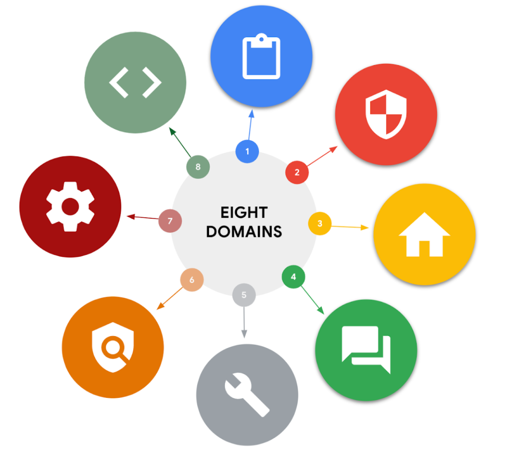

# 📚 Security domains

## 🛡️ The 8 CISSP Security Domains

**Source:** Google Cybersecurity Professional Certificate, Google/Coursera, course material. Image used for educational/reference purposes.

### 🔒 1. Security and Risk Management

* **Focus:** Developing and maintaining an organization's overall security posture and defense capabilities against changes and threats.
* **Key Elements:** Security goals, risk mitigation processes, compliance (e.g., GDPR), business continuity plans, legal regulations, and professional ethics.
* **InfoSec Processes:** Incident response, vulnerability management, application security, cloud security, and infrastructure security.

### 📦 2. Asset Security

* **Focus:** Managing cybersecurity processes for organizational assets, including storage, maintenance, retention, and destruction of physical and virtual data.
* **Key Elements:** Accurate asset/data tracking, security impact analysis, recovery plans, and data exposure management.
* **Practical Example:** Creating and managing backups to ensure environment restoration during a security incident.

### 🏗️ 3. Security Architecture and Engineering

* **Focus:** Managing data security through effective tools, systems, and processes created by security architects and engineers.
* **Key Elements:** Shared responsibility, threat modeling, least privilege, defense in depth, fail securely, separation of duties, and Zero Trust architecture.
* **Practical Example:** Using SIEM (*Security Information and Event Management*) tools to monitor for unusual login or user activity.

### 🌐 4. Communication and Network Security

* **Focus:** Managing and securing physical networks, wireless communications, and remote, hybrid, or on-site work environments.
* **Key Elements:** Network security controls (such as restricted network access) and external connection management for remote workers.
* **Objective:** Ensuring data remains secure regardless of employee locations.

### 🔑 5. Identity and Access Management (IAM)

* **Focus:** Ensuring user identities are trusted and authenticated, authorizing access only to legitimate physical and logical assets.
* **Core Principle:** Least privilege (granting only the minimal access required to complete a task).
* **Practical Example:** Granting temporary access to customer data to a support representative only while resolving an issue, then removing access afterward.

### 🔍 6. Security Assessment and Testing

* **Focus:** Proactively identifying and mitigating risks, threats, and vulnerabilities across internal systems.
* **Key Elements:** Penetration testing (*pen testers*), security control testing, data collection, audits, and user permission validation.
* **Objective:** Reducing the probability of a data breach by catching flaws before threat actors do.

### 🚨 7. Security Operations

* **Focus:** Investigating potential data breaches and implementing preventative measures after a security incident occurs.
* **Key Elements:** Training and awareness, reporting/documentation, intrusion detection and prevention, SIEM tools, log management, incident management, playbooks, post-breach forensics, and lessons learned.
* **Objective:** Managing and mitigating active attacks in real-time to protect private information.

### 💻 8. Software Development Security

* **Focus:** Applying secure programming practices and guidelines throughout the entire Software Development Life Cycle (SDLC).
* **Key Elements:** Security must be integrated from design through testing and release (never an afterthought), application testing, and quality assurance (QA).
* **Practical Example:** Ensuring proper encryption configuration for a new medical device storing private patient data.

---

## 📉 Managing Security Risks and Threats

### 🔍 Understanding Risk Management

* **Focus:** Protecting organizational assets (both digital and physical) from threats, risks, and vulnerabilities using frameworks like the NIST Risk Management Framework (RMF) and HITRUST.
* **Key Elements:**
  * **Digital Assets:** Personal identifiable information (PII) such as Social Security Numbers (SSNs), dates of birth, bank account numbers, and mailing addresses.
  * **Physical Assets:** Payment kiosks, servers, desktop computers, and office spaces.
* **Risk Management Strategies:**
  * **Acceptance:** Accepting a risk to avoid disrupting business continuity.
  * **Avoidance:** Creating a plan to avoid the risk altogether.
  * **Transference:** Transferring risk to a third party to manage.
  * **Mitigation:** Lessening the impact of a known risk.

### ⚠️ Today’s Most Common Threats, Risks, and Vulnerabilities

### 🎯 Threats

* **Definition:** Any circumstance or event that can negatively impact assets from the inside or outside.
* **Key Examples:**
  * **Insider threats:** Staff members or vendors abusing authorized access.
  * **Advanced persistent threats (APTs):** Threat actors maintaining unauthorized access to a system for an extended period.

### 📊 Risks

* **Definition:** Anything that can impact the confidentiality, integrity, or availability of an asset (Risk equals the likelihood of a threat).
* **Key Factors:**
  * **External risk:** Outside factors or threat actors attempting to gain access to private information.
  * **Internal risk:** Current or former employees, vendors, or trusted partners.
  * **Legacy systems:** Outdated or unmanaged systems (e.g., old workstations or mainframes).
  * **Multiparty risk:** Third-party vendors accessing intellectual property or trade secrets.
  * **Software compliance/licensing:** Outdated software or unapplied patches.
* **Industry Standards:** Utilizing resources like NIST guidelines and the **OWASP Top 10** standard awareness document for critical security risks to web applications.

### 🔓 Vulnerabilities

* **Definition:** A weakness that can be exploited by a threat, requiring regular inspection and vulnerability management.
* **Key Vulnerability Examples:**

  * **ProxyLogon:** A pre-authenticated vulnerability affecting Microsoft Exchange servers. This means a threat actor can complete a user authentication process to deploy malicious code from a remote location.
  * **ZeroLogon:** A vulnerability in Microsoft’s Netlogon authentication protocol. An authentication protocol is a way to verify a person's identity. Netlogon is a service that ensures a user’s identity before allowing access to a website's location.
  * **Log4Shell:** Allows attackers to run Java code on someone else’s computer or leak sensitive information. It does this by enabling a remote attacker to take control of devices connected to the internet and run malicious code.
  * **PetitPotam:** Affects Windows New Technology Local Area Network (LAN) Manager (NTLM). It is a theft technique that allows a LAN-based attacker to initiate an authentication request.
  * **Security logging and monitoring failures:** Insufficient logging and monitoring capabilities that result in attackers exploiting vulnerabilities without the organization knowing it
  * **Server-side request forgery:** Allows attackers to manipulate a server-side application into accessing and updating backend resources. It can also allow threat actors to steal data.
* **Practical Role:** Monitoring systems constantly, identifying weaknesses early, and applying patches or updates to reduce exposure.

---

---

# 📚Security Frameworks and Controls

## 📋 Frameworks and Controls Overview

* **Focus:** Using security frameworks and controls together to help mitigate organizational risk, protect data and privacy, and support regulatory compliance.
* **Security Frameworks:** Guidelines used to build risk-mitigation plans and comply with laws (e.g., complying with HIPAA in the healthcare industry)
* **Security Controls:** Safeguards designed to reduce specific security risks (e.g., using multi-factor authentication, or MFA).

### 📐 Specific Frameworks

#### 🌐 Cyber Threat Framework (CTF)

* **Definition:** Developed by the U.S. government to provide a common language for describing and communicating information about cyber threat activity.
* **Purpose:** Helps professionals analyze and share information efficiently to improve responses to evolving threat tactics and techniques.

#### 🌐 International Organization for Standardization / International Electrotechnical Commission (ISO/IEC) 27001

* **Definition:** An internationally recognized family of standards enabling organizations of all sizes to manage asset security (financial info, IP, employee data, third-party data).
* **Purpose:** Outlines information security management system (ISMS) requirements, best practices, and a collection of optional controls to improve security posture.

### ⚙️ Security Control Categories

* **Objective:** Used alongside frameworks to reduce the possibility and impact of threats, risks, and vulnerabilities through physical, technical, and administrative measures (preventing, detecting, or correcting issues).

#### 🚪 Physical Controls

* **Examples:** Gates, fences, locks, security guards, CCTV/surveillance cameras, motion detectors, and access cards/badges.

#### 💻 Technical Controls

* **Examples:** Firewalls, multi-factor authentication (MFA), and antivirus software.

#### 📄 Administrative Controls

* **Examples:** Separation of duties, authorization, and asset classification.

---

## 🔒 The CIA Triad for Cybersecurity Analysts

* **Focus:** Using the confidentiality, integrity, and availability (CIA) triad model to inform risk considerations, system design, and security policies.
* **Security Posture:** Maintaining an acceptable risk level and applying these elements helps establish an organization's defense and reaction capabilities.

### 👁️ Confidentiality

* **Definition:** Ensuring that only authorized users can access specific assets or data.
* **Key Implementation:** Utilizing design principles like the **principle of least privilege** to limit user access solely to the information required for work-related tasks.

### ✅ Integrity

* **Definition:** Ensuring that data is verifiably correct, authentic, and reliable.
* **Key Mechanisms:**
  * **Cryptography:** Transforming data so unauthorized parties cannot read or tamper with it (NIST, 2022).
  * **Encryption:** Converting readable data into an encoded format to prevent tampering (e.g., protecting messages on internal chat platforms).

### 🔓 Availability

* **Definition:** Ensuring that data remains accessible to authorized users whenever it is needed.
* **Practical Application:** Permitting remote employees to access internal corporate networks to perform their jobs, while maintaining controlled access boundaries based on specific department needs (e.g., accounting personnel accessing accounts rather than development data).

---

## 🛡️ OWASP Security Principles

**Focus:** Integrating security principles into daily analyst tasks—such as log analysis, monitoring SIEM dashboards, or using vulnerability scanners.

### 🔑 Core OWASP Principles (Review)

* **Minimize attack surface area:** Reducing all potential vulnerabilities that a threat actor could exploit.
* **Principle of least privilege:** Granting users the minimum amount of access required for their everyday tasks.
* **Defense in depth:** Implementing varying security controls to mitigate risks and threats.
* **Separation of duties:** Distributing critical actions across multiple people under the principle of least privilege.
* **Keep security simple:** Avoiding unnecessarily complex solutions that make security difficult.
* **Fix security issues correctly:** Finding root causes, containing impacts, identifying vulnerabilities, and testing remediation success.

### ➕ Additional OWASP Security Principles

#### ⚙️ Establish Secure Defaults

* **Definition:** An application's optimal security state should be its default state for users, meaning it takes extra effort to make the application insecure.

#### 🔌 Fail Securely

* **Definition:** Ensuring that when a security control fails or stops working, it defaults to the most secure option.
* **Practical Example:** A failing firewall should close all connections and block new ones rather than accept all traffic.

#### 🚫 Don’t Trust Services

* **Definition:** Organizations must not explicitly trust the security systems of third-party partners, as outside partners often have different policies.
* **Practical Example:** An airline partnering with a third-party vendor that tracks reward points should independently verify balance accuracy before sharing information with customers.

#### 🔍 Avoid Security by Obscurity

* **Definition:** Key system security should not rely purely on keeping design details or source code hidden.
* **Key Factors:** Security must rely on robust factors like reasonable password policies, defense in depth, transaction limits, solid network architecture, and fraud/audit controls.

--

## 🔍 Security Audits and Compliance

* **Definition:** An independent review evaluating whether an organization meets internal criteria (policies, procedures, best practices) and external criteria (regulatory compliance, laws, federal regulations).
* **Purpose:** Assesses established security controls, ensures daily monitoring checks are performed, and identifies threats, risks, and vulnerabilities to maintain security posture.
* **Goals and Objectives:** Ensure IT practices meet industry standards, identify areas for remediation and growth, safeguard data, and avoid governmental fines and penalties.
* **Determining Factors:** Audit types depend on industry type, organization size, government regulations, geographical location, and voluntary compliance choices.
* **Role of Frameworks:** Frameworks like NIST CSF and ISO 27000 help organizations prepare for audits and save time during internal and external reviews.

### 📝 Audit Checklist Steps

* **1. Identify the Scope:** List assets to assess, note audit goals, set performance frequency, and evaluate policies/procedures.
* **2. Complete a Risk Assessment:** Evaluate identified risks related to budgets, controls, internal processes, and regulations.
* **3. Conduct the Audit:** Assess the security of identified assets listed in the audit scope.
* **4. Create a Mitigation Plan:** Establish strategies to lower risk levels, penalties, and potential costs.
* **5. Communicate Results:** Provide detailed findings, improvement suggestions, and relevant compliance standards to stakeholders.

### ⚖️ Common Compliance Regulations

* **GDPR (General Data Protection Regulation):** Protects EU citizens' data processing and privacy rights both in and out of EU territory; mandates informing authorities/individuals of breaches within 72 hours.
* **PCI DSS (Payment Card Industry Data Security Standard):** International standard ensuring secure environments for organizations that store, accept, process, and transmit credit card information.

---

---

# 📚Cybersecurity Tools

## 📊 Security Information and Event Management (SIEM) Tools

### 📌 Current SIEM Solutions

* **Definition:** An application that collects and analyzes log data to monitor critical activities within an organization.
* **Capabilities:** Offer real-time monitoring and tracking of security event logs to conduct thorough analyses of potential threats, risks, or vulnerabilities.
* **Human Interaction:** Currently, SIEM tools require human interaction to analyze security events.

### ☁️ The Future of SIEM Tools

* **Cloud-Hosted SIEM Tools:** Operated by vendors responsible for maintaining and managing the required infrastructure; an ideal solution for organizations that prefer not to build and maintain their own infrastructure.
* **Cloud-Native SIEM Tools:** Fully maintained and managed by vendors and accessed via the internet, designed to take full advantage of cloud computing capabilities such as availability, flexibility, and scalability.
* **Attack Surface Expansion (IoT):** The rise of interconnected internet-accessible devices (Internet of Things) increases the cybersecurity attack surface and the volume of data threat actors can exploit.
* **Artificial Intelligence (AI) and Machine Learning (ML):** Continued progress will enhance SIEM capabilities to better identify threat-related terminology, improve dashboard visualization, and optimize data storage functionality.
* **Automation and SOAR:** Security orchestration, automation, and response (SOAR) uses workflows to automate responses to common security events, reducing manual intervention and freeing up security analysts to handle more complex, uncommon incidents.

## 🛠️ Open-Source and Proprietary Cybersecurity Tools

### 🔓 Open-Source Tools

* **Definition:** Software built collaboratively by the public that is often free to use, highly customizable, and focused on community-driven security improvements.
* **Source Code Access:** Readily available source code and training materials allow users to modify, improve, and adapt project materials under specified licenses.
* **Safety Misconception:** While some assume open-source tools are less safe, their wide exposure and immediate access by well-intentioned professionals make it harder for threat actors to cause prolonged harm, as issues can be fixed as soon as they are identified.
* **Key Examples:**
  * **Linux:** A widely used open-source operating system utilizing a command-line interface to manage computer hardware and software applications.
  * **Suricata:** An open-source network analysis and threat detection software developed by the Open Information Security Foundation (OISF) to inspect network traffic and uncover potential threats.

### 💼 Proprietary Tools

* **Definition:** Software developed and owned by an individual or company where users typically pay a fee for usage and training.
* **Source Code Restriction:** Only owners can access and modify the source code, meaning users must wait for vendor updates (sometimes paid) and can only customize a limited number of features.
* **Key Examples:** Commercial SIEM tools like Splunk® and Google SecOps (Chronicle).

## 🖥️ Using SIEM Tools to Protect Organizations

### 🔍 Splunk SIEM Dashboards

* **Overview:** Splunk offers Splunk® Enterprise and Splunk® Cloud options to collect, search, monitor, and analyze log data from multiple sources for complete visibility.
* **Security Posture Dashboard:** Designed for SOCs to display the last 24 hours of security-related events and trends, allowing real-time investigation of suspicious network activity.
* **Executive Summary Dashboard:** Analyzes and monitors overall organizational health over time, helping provide high-level summaries of security incidents to stakeholders.
* **Incident Review Dashboard:** Highlights higher-risk items needing immediate review and provides a visual timeline of events leading up to an incident.
* **Risk Analysis Dashboard:** Tracks risk-related activity per risk object (user, computer, IP address) to help analysts prioritize risk mitigation efforts.

### ☁️ Google SecOps (Chronicle) Dashboards

* **Overview:** A cloud-native SIEM tool that retains, analyzes, and searches log data based on specific assets, domain names, users, or IP addresses.
* **Enterprise Insights Dashboard:** Highlights recent alerts, flags indicators of compromise (IOCs) with confidence scores and severity levels, and tracks unusual login/data access attempts.
* **Data Ingestion and Health Dashboard:** Shows event log counts, sources, and processing success rates to ensure proper log configuration and error-free ingestion.
* **IOC Matches Dashboard:** Tracks domain names, IP addresses, and device IOCs over time to identify trends and direct focus to high-priority threats.
* **Main Dashboard:** Displays high-level summaries of data ingestion, alerts, and event activity timelines to spot threat trends across sources and locations.
* **Rule Detections Dashboard:** Provides statistics on recurring incidents and triggered alerts (e.g., malicious email attachments) to establish mitigation tactics.
* **User Sign In Overview Dashboard:** Tracks user access behavior to spot anomalous activities, such as simultaneous logins from multiple locations.

---

---

# 📚Cybersecurity Playbooks

## 📋 Playbook Overview

* **Definition:** A manual providing operational details, including a predefined and up-to-date list of steps to follow when responding to an incident.
* **Structure:** Accompanied by a strategy (outlining team member expectations and responsibilities) and a plan (dictating how specific tasks must be completed).
* **Living Documents:** Managed collaboratively and updated frequently by security teams to address industry shifts and new threats.
* **Common Update Triggers:** Addressing identified failures/oversights, changes in industry standards or compliance laws, and evolving threat actor tactics.

## 🚨 Incident and Vulnerability Response Playbooks

* **Purpose:** Commonly used by entry-level professionals and developed based on business continuity plan goals to help organizations recover from disruptions.
* **Benefits:** Ensure adherence to legal and organizational standards, minimize errors, and guarantee important actions occur within specific timeframes.
* **Forensic Significance:** Following playbook steps prevents data mishandling, which could otherwise compromise forensic data and render it unusable.
* **Common Playbook Steps:**
  * **Preparation**: Before incidents occur, mitigate potential impacts on the organization by documenting, establishing staffing plans, and educating users.
  * **Detection & Analysis**: Detect and analyze events by implementing defined processes and appropriate technology.
  * **Containment**: Prevent further damage and reduce immediate impact of incidents.
  * **Eradication & Recovery:** Completely remove artifacts of the incident so that an organization can return to normal operations.
  * **Post-incident activities:** Document the incident, inform organizational leadership, and apply lessons learned.
  * **Coordination**: Report incidents and share information throughout the response process, based on established standards.

## 🔄 Playbooks and SIEM Tools

* **Purpose:** Playbooks help security teams respond to incidents by ensuring a consistent, prescribed list of actions is followed regardless of who is working on the case.
* **Detail Level:** They can be highly detailed and include flow charts and tables to clarify action sequences, such as recovery procedures for ransomware attacks.
* **SIEM Integration:** Playbooks are used alongside SIEM tools; for instance, when a SIEM flags unusual user behavior, the playbook provides instructions on how to handle the issue.

## ⚡ Playbooks and SOAR Tools

* **SOAR Definition:** Security orchestration, automation, and response (SOAR) software is used to automate repetitive tasks generated by tools like SIEMs or managed detection and response (MDR).
* **Automation Example:** If a user attempts to log in too many times with an incorrect password, a SOAR automatically blocks the account to stop a potential intrusion.
* **Resolution Role:** After a SOAR automates initial actions, analysts refer to playbooks to execute the necessary steps for full issue resolution.
* **Key Takeaway:** Playbooks (also known as runbooks) outline exact responsibilities and timing for security teams during incidents, minimizing damage and risk to critical assets.
