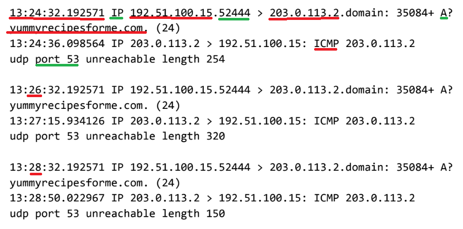

# Cybersecurity Incident Report & Technical Analysis: Network Traffic Investigation

## Exercise Overview & Scenario Description

* **Context:** You are a cybersecurity analyst working for an IT managed services provider.
* **Incident Description:** Several customers of client companies reported being completely unable to access the website `www.yummyrecipesforme.com`. Upon attempting to load the page, users experienced a timeout followed by the error message: *"destination port unreachable"*.
* **Initial Troubleshooting & Tooling:**

  * As an analyst, you attempted to visit the website and encountered the same error.
  * To diagnose the underlying network issue, you deployed `tcpdump`, a powerful network protocol analyzer tool, to capture packets in transit during a web access attempt.
  * The tool revealed that your browser attempted to send a DNS query via UDP to resolve the domain name to an IP address, but instead of a valid DNS response, the network returned ICMP error messages indicating `udp port 53 unreachable`.
  * 

## Incident Report Resolution & Validation

### Part 1: Summary of the Problem Found in the DNS and ICMP Traffic Log

* **The UDP protocol reveals that:** An initial outgoing query was transmitted from the client's IP address (`192.51.100.15`) to the designated DNS server (`203.0.113.2`), requesting an A (IPv4) record for the domain `www.yummyrecipesforme.com` over UDP port 53.
* **This is based on the results of the network analysis, which show that the ICMP error reply returned the message:** `ICMP 203.0.113.2 udp port 53 unreachable`.
* **The port noted in the error message is used for:** DNS service (Domain Name System) name resolution operations.
* **The most likely issue is:** The DNS service is unavailable on UDP port 53, potentially because the DNS service is down or because a firewall/network configuration is blocking the traffic.

### Part 2: Analysis of the Data and Likely Cause of the Incident

* **Time Incident Occurred:** 1:24 p.m. (with logs starting precisely at timestamp `13:24:32.192571`).
* **How the IT Team Became Aware:** Client customers reported total service disruption when trying to access `www.yummyrecipesforme.com`, accompanied by port unreachable errors.
* **Actions Taken by IT/Security Department:** Verified the failure firsthand, initiated `tcpdump`, and captured serial log entries showing repeated failed UDP queries matched with repeated ICMP port unreachable replies.
* **Key Findings of the Investigation:** The log confirms that communication breaks down specifically at the name resolution stage. Because UDP port 53 is closed or unresponsive on the DNS server, the browser cannot translate the domain name into an IP address, without successful DNS resolution, the client cannot normally establish an HTTPS connection to the website using that domain name.
* **Suspected Root Cause:** The DNS server application has crashed, stopped unexpectedly, or a perimeter security device/firewall rule is erroneously dropping UDP traffic destined for port 53.
* **Next Steps for Remediation:**

  1. Coordinate with system administrators to verify if the DNS service daemon is running.
  2. Inspect firewall and router configurations to ensure UDP port 53 traffic is permitted.
  3. Review server logs for potential signs of resource exhaustion or malicious interference.

## Formal: Incident Report Resolution & Validation

### Part 1: Summary of the Problem Found in the DNS and ICMP Traffic Log

The tcpdump log shows that the client's computer (`192.51.100.15`) sent DNS queries to the DNS server (`203.0.113.2`) using the UDP protocol on port 53. The queries requested an A record for `yummyrecipesforme.com`, which is used to resolve the domain name to an IPv4 address. The DNS queries were followed by ICMP responses from `203.0.113.2` to `192.51.100.15` containing the error message `udp port 53 unreachable`. This indicates that the UDP packet could not be delivered because no service was listening on the DNS server's UDP port 53. The same query and error occurred three times, indicating that the DNS resolution request repeatedly failed. The affected services and protocols were DNS over UDP port 53, with ICMP being used to report the delivery error. Because DNS resolution failed, the client could not obtain the IP address needed to access the website.

### Part 2: Analysis of the Data and Likely Cause

The issue was first observed at approximately 1:24 p.m., with the first DNS request appearing in the tcpdump log at `13:24:32.192571`. Customers reported that they were unable to access `www.yummyrecipesforme.com` and received a "destination port unreachable" error after waiting for the webpage to load. During the investigation, tcpdump was used to capture the network traffic generated when attempting to access the website. The capture showed that the client sent a DNS query using UDP to the DNS server `203.0.113.2` on port 53. The query requested an A record for the website's domain. Instead of receiving a DNS response containing the requested IP address, the client received an ICMP message stating `udp port 53 unreachable`. The issue was repeated two additional times, with the same DNS query followed by the same ICMP error. This indicates that the DNS service was unavailable because no service was listening on UDP port 53. As a result, the domain name could not be resolved to an IP address, preventing the client from normally connecting to the website. The suspected root cause is that the DNS service on the server was stopped, crashed, or otherwise not listening on UDP port 53. The next step is to verify that the DNS service is running and listening on UDP port 53. If the service is stopped, it should be restarted and monitored. The security or network team should also verify the server and firewall configuration to ensure that DNS traffic over UDP port 53 is permitted. Server and DNS logs should then be reviewed to determine why the service became unavailable.
