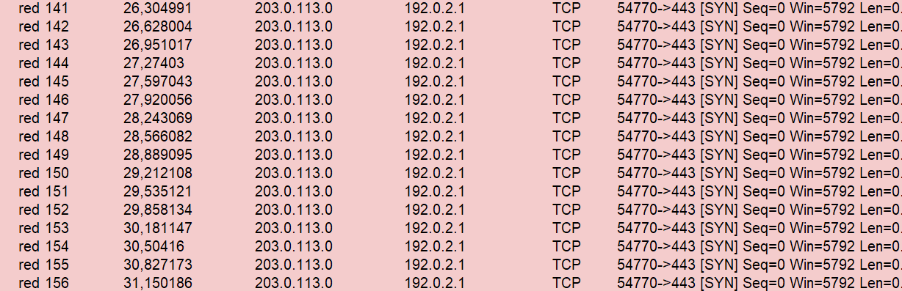

# Cybersecurity Incident Report: Network Intrusion & Denial of Service Analysis

## Exercise Overview & Scenario Description

* **Context:** You work as a security analyst for a travel agency where employees regularly access the company's sales webpage (`/sales.html`) to search for vacation packages.
* **Incident Description:** An automated monitoring alert indicated a problem with the web server. When attempting to visit the company's website, users experienced a connection timeout error.
* **Initial Investigation & Findings:** Using a packet sniffer (`Wireshark` / log analysis), analysts discovered a massive volume of TCP SYN requests coming from an unfamiliar external IP address (`203.0.113.0`). The server was completely overwhelmed, losing its ability to process incoming traffic.
* **Mitigation Actions Taken:** The server was temporarily taken offline to recover, and the perimeter firewall was configured to block the offending IP address. However, due to potential IP spoofing, further long-term defensive measures are required.

## Incident Report Resolution

### Section 1: Identify the Type of Attack Causing the Network Interruption

* **One potential explanation for the website's connection timeout error message is:** The web server is completely overwhelmed by an abnormal volume of incoming connection requests, exhausting its resources and failing to respond to users.
* **The logs show that:** A continuous stream of TCP SYN packets is flooding the server from an external source IP address (`203.0.113.0`), creating numerous half-open connections.
* **This event could be:** A Denial of Service (DoS) attack, specifically a TCP SYN Flood attack originating from a specific source IP (though potentially utilizing IP spoofing).

### Section 2: Explain How the Attack Causes the Website to Malfunction

* **TCP Three-Way Handshake Steps:**
  1. **SYN:** The client initiates connection by sending a SYN packet.
  2. **SYN-ACK:** The server responds with SYN-ACK, acknowledging the client.
  3. **ACK:** The client replies with an ACK packet, finalizing the connection.
* **Impact of Massive SYN Packets:** The attacker overwhelms the server with connection requests while refusing to complete the handshake. The server wastes system memory and resources tracking these half-open states.
* **Log Indications & Server Effects:** The logs indicate an intense influx of TCP SYN requests targeting port 443. This starves the server of resources, driving up latency, causing request drops, and resulting in connection timeouts for legitimate visitors.

## Remediation & Next Steps

1. **Immediate Actions:** Temporary server reboot/offline recovery and firewall IP blocking executed.
2. **Long-term Security Recommendations:**
   * Implement **SYN Cookies** on the operating system / network stack to handle half-open connection surges without exhausting memory.
   * Configure rate-limiting rules on perimeter firewalls and load balancers.
   * Deploy upstream DDoS mitigation services (such as Cloudflare or AWS Shield) to filter out spoofed traffic before it reaches the origin server.
