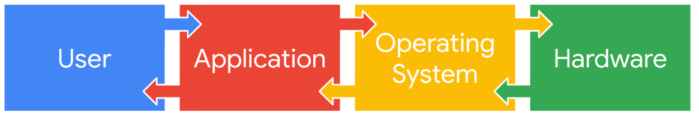

# 📚Introduction to Operation Systems

An operating system (OS) is  the core software that manages a computer's hardware and software resources. It acts as an intermediary between user applications and the physical hardware.

## 🖥️ Common Operating Systems

* **Windows:** Closed-source OS introduced in 1985, widely used for personal and enterprise computers.
* **macOS:** Introduced in 1984, featuring partially open-source components (such as its kernel) alongside closed-source elements.
* **Linux:** Completely open-source OS released in 1991, allowing community collaboration and hosting distributions specifically tailored for security.
* **ChromeOS:** Launched in 2011 and partially open-source, derived from the fully open-source Chromium OS and frequently used in education.
* **Android & iOS:** Mobile operating systems for phones, tablets, and watches (Android introduced in 2008 as open-source; iOS introduced in 2007 as partially open-source).

## ⚠️ Legacy Operating Systems and Vulnerabilities

* **Legacy Systems:** Outdated operating systems that are still actively used—often because critical legacy software or embedded equipment is incompatible with newer platforms.
* **Security Risks:** Because legacy systems no longer receive official support or updates, they remain uniquely exposed to newly discovered threats and exploits.
* **Vulnerability Tracking Resources:** Security analysts track ongoing operating system vulnerabilities through standardized reporting channels:
  * **Microsoft Security Response Center (MSRC):** Tracks known vulnerabilities affecting Microsoft products and services.
  * **Apple Security Updates:** Provides updates and security details for macOS, iOS, and other Apple products.
  * **CVE Reports (e.g., Ubuntu):** Lists known vulnerabilities impacting specific Linux distributions.
  * **Google Cloud Security Bulletin:** Details vulnerabilities affecting Google Cloud infrastructure and services.~

---

## ⚙️ Operating System Architecture, Booting, and Request Handling

### 🚀 Booting the Computer

* **Firmware Initialization:** When turning on a computer, the boot process activates either a traditional **BIOS** or modern **UEFI** microchip containing core loading instructions.
* **Evolution of Boot Microchips:**
  * **BIOS (Basic Input/Output System):** Prevalent in older systems as the standard boot microchip until 2007.
  * **UEFI (Unified Extensible Firmware Interface):** Replaced BIOS on modern systems, providing enhanced security features.
* **Bootloader Activation:** After verifying hardware health and executing loading routines, the final instruction from the BIOS/UEFI chip activates the **bootloader** software program to load the operating system.

### 🔄 Task Execution Pipeline: The Four-Part Process

* **1. User:** Initiates the request to accomplish a specific task on the computer (e.g., clicking a download button or opening an application).
* **2. Application:** The software interface interacted with by the user to process the task (e.g., word processors, calculators, web browsers).
* **3. Operating System (OS):** Acts as the bridge behind the scenes (comparable to a restaurant kitchen preparing an order) by receiving, interpreting, and routing requests from applications to the appropriate hardware.
* **4. Hardware:** The physical components (such as the CPU for calculations or the hard drive for file storage) that perform the heavy processing and return the output through the OS to the application.



### 📥 Example: Downloading a File from an Internet Browser

* **Step 1 (User Action):** The user clicks a download button near a file within the web browser application.
* **Step 2 (Application Communication):** The browser application transmits the download action request to the operating system.
* **Step 3 (OS Processing):** The OS directs the download request to the appropriate hardware components.
* **Step 4 (Completion & Feedback):** The hardware executes the download, sending status updates through the OS back to the browser, which notifies the user upon completion.

---

## 🖥️ Virtualization Technology and Virtual Machines

### 🌐 What is a Virtual Machine (VM)?

* **Definition:** A virtual machine is a software-defined representation of a physical computer. It uses software to simulate physical hardware (such as a virtual CPU and storage) rather than relying on dedicated physical components.
* **Resource Sharing:** Multiple virtual machines can run on a single physical host by dividing and sharing hardware resources. For example, a computer with 16GB of RAM can allocate memory chunks so that the host and multiple guest VMs operate simultaneously.
* **Independent Operating Systems:** Each virtual machine runs its own operating system, functioning just like a typical standalone computer.

### 🛡️ Benefits of Virtual Machines in Security and Efficiency

* **Isolation & Sandboxing:** VMs provide an isolated environment separate from the host computer and other guest machines. If a VM is infected with malware, it can be handled securely or used intentionally to analyze malicious code safely. *(Note: A minor risk of a "VM escape" remains, where advanced malware could potentially break out to the host).*
* **Efficiency:** Multiple virtual machines run on a single physical machine, eliminating the need for separate physical hardware for every task. This can be compared to a city bus transporting many people efficiently instead of everyone driving separate cars.

### 🎛️ Managing VMs and Other Forms of Virtualization

* **Hypervisors:** Software tools used to manage multiple virtual machines, connect virtual and physical hardware, and allocate shared host resources.
  * **Kernel-based Virtual Machine (KVM):** An open-source hypervisor built directly into the Linux kernel, allowing users to create VMs on Linux distributions without needing additional software.
* **Other Forms of Virtualization:** Beyond individual VMs, organizations can create multiple virtual servers from a single physical server or configure virtual networks to use physical network hardware more efficiently.

---

## 💻 GUI vs. CLI: Interfaces in Cybersecurity

### 🖥️ Graphical User Interfaces (GUI) vs. Command-Line Interfaces (CLI)

* **Display Differences:**
  * **GUI:** Utilizes graphics, windows, icons, and elements on a desktop or taskbar to manage tasks visually.
  * **CLI:** A text-based user interface that resembles lines of code and relies entirely on typed commands.
* **Functional Differences:**
  * **GUI:** Typically processes and handles one user request at a time through direct interaction.
  * **CLI:** Capable of accepting and executing multiple requests concurrently, offering greater speed and flexibility for complex operations.

### ⚡ Advantages of a CLI in Cybersecurity

* **Efficiency & Power:**
  * While beginners may find GUIs easier to navigate, experienced users can work much faster in a CLI.
  * Because a CLI can handle multiple requests at once, tasks like creating multiple new files or configuring settings can be done instantly compared to repeating repetitive steps in a GUI.
* **Built-In History File:**
  * Linux CLIs automatically record a history file of all executed commands and actions.
  * **Incident Response & Playbooks:** Security analysts can review command history to ensure incident response steps or playbooks were followed correctly, or audit commands if errors occur.
  * **Forensic Tracking:** Analysts can inspect the history file to trace and analyze the actions of a potential intruder who compromised the system.

---

---

# 📚Linux operating systm

## 🔄 The Linux Architecture Pipeline

* **Data/Request Flow:** A request to complete a task follows a structured flow through the Linux system: **User ➔ Applications ➔ Shell ➔ Filesystem Hierarchy Standard (FHS) ➔ Kernel ➔ Hardware**.

## 🏗️ Core Components of the Linux Architecture

* **1. User:**
  * The individual interacting with the computer who initiates and manages tasks. Linux is inherently a **multi-user system**, allowing multiple users to share resources simultaneously.
* **2. Applications:**
  * Programs that perform specific tasks (e.g., pre-installed utilities, web browsers, email clients).
  * In Linux, users typically manage applications using a **package manager**, a tool used to install, update, manage, and remove software packages.
* **3. Shell:**
  * The text-based command-line interpreter that acts as a translator between the user and the kernel, allowing users to enter commands and receive system responses.
* **4. Filesystem Hierarchy Standard (FHS):**
  * The organizing component that defines directory structures, file locations, and how storage is arranged so the operating system knows precisely where to find data.
* **5. Kernel:**
  * The core component of the Linux OS that manages processes, system memory, and resource allocation. It communicates directly with applications to route commands and controls major hardware functions.
* **6. Hardware:**
  * The physical components of the computer system, split into two primary categories:
    * **Peripheral Devices:** Non-core external components that can be added or removed freely (e.g., monitors, keyboards, mice, printers).
    * **Internal Hardware:** Essential components attached to the motherboard required to run the computer:
      * **Central Processing Unit (CPU):** The main processor that executes program instructions.
      * **Random Access Memory (RAM):** Short-term, volatile memory used to temporarily store data for active programs while the computer is powered on.
      * **Hard Drive:** Long-term storage used to save programs and files persistently across reboots.

---

## 🐧 Major Linux Distributions in Cybersecurity

### 🕵️ Security-Focused Linux Distributions

* **Kali Linux:**
  * An open-source, Debian-based distribution widely used across the security industry for **penetration testing** (simulated attacks to identify vulnerabilities) and **digital forensics** (collecting and analyzing post-attack data).
  * Pre-installed with a vast array of specialized security tools. *(Kali Linux is a trademark of OffSec).*
* **Parrot Security:**
  * An open-source, Debian-based distribution also designed specifically for security, penetration testing, and digital forensics.
  * Known for being user-friendly, providing both a command-line interface (CLI) and an easy-to-navigate graphical user interface (GUI).

### 🏢 Enterprise and General-Purpose Distributions

* **Ubuntu:**
  * An open-source, user-friendly, Debian-derived distribution equipped with both a GUI and CLI, backed by an extensive community support network.
  * Widely adopted across general industries, cloud computing environments, and server infrastructure.
* **Red Hat Enterprise Linux (RHEL):**
  * A subscription-based, commercial Linux distribution built specifically for enterprise environments, offering professional dedicated support teams for business-critical operations.
* **AlmaLinux:**
  * A community-driven, open-source Linux distribution created as a stable, drop-in replacement for CentOS (following the end of CentOS 8 support).
  * Designed to ensure that applications and configurations originally built for CentOS continue to function seamlessly.

---

## 📦 Linux Package Managers and Management Tools

### 📋 Introduction to Packages and Dependencies

* **Packages:** Individual pieces of software, or collections of files, that combine to form a complete application.
* **Dependencies:** Supplemental files and libraries required for an application to run correctly.
* **Package Managers:** Tools designed to install, manage, update, and remove packages while automatically resolving dependency issues.
* **Security Best Practice:** Always use the most recent version of a package when possible to ensure your system benefits from up-to-date bug fixes and critical security patches.

### 🗂️ Types of Package Managers and Ecosystems

Different Linux distributions rely on distinct package manager ecosystems based on their parent distributions:

* **Debian-Derived Distributions (e.g., Ubuntu, Kali Linux, Parrot):**
  * **Manager:** `dpkg`
  * **File Extension:** `.deb`
  * **Naming Convention Example:** `Package_Version-Release_Architecture.deb`
* **Red Hat-Derived Distributions (e.g., RHEL, CentOS):**
  * **Manager:** Red Hat Package Manager (RPM)
  * **File Extension:** `.rpm`
  * **Naming Convention Example:** `Package-Version-Release_Architecture.rpm`

### 🛠️ Command-Line Package Management Tools

To simplify interacting with packages through the shell, higher-level command-line management tools are typically used on top of core package managers:

* **Advanced Package Tool (APT):**
  * Used with Debian-derived distributions.
  * Executed from the command-line interface to easily search, manage, and install `.deb` packages and software repositories.
* **Yellowdog Updater Modified (YUM):**
  * Used with Red Hat-derived distributions.
  * Executed from the command-line interface to manage, search, and install `.rpm` packages and handle dependency trees automatically.

---

## 🐚 Linux Shells and the Bash Shell

### 🔄 Understanding Shells

* **Definition:** A shell is a text-based command-line interpreter that acts as a translator between the user and the computer's kernel, allowing users to issue commands and receive system responses.
* **Internal Processes:** When a command is entered, the shell executes multiple internal steps to interpret the instruction, route it through the kernel, and return the output.

### 📋 Types of Linux Shells

While all Linux shells share common core commands, they differ in syntax features, prompt indicators, and advanced scripting capabilities:

* **Bourne-Again Shell (bash):** Uses the dollar sign (`$`) prompt indicator.
* **C Shell (csh):** Modeled after the C programming language syntax.
* **Korn Shell (ksh):** Uses the dollar sign (`$`) prompt indicator and includes advanced scripting features.
* **Enhanced C shell (tcsh):** An updated version of the C shell with programmable completion.
* **Z Shell (zsh):** Uses the percent sign (`%`) prompt indicator and offers extensive customization and modern features.

### ⚡ The Bash Shell in Cybersecurity

* **Default Status:** Bash is the default shell in most Linux distributions.
* **Industry Standard:** It is the most popular and widely used shell in the cybersecurity profession due to its user-friendliness, reliability, and robust support for both basic commands and complex scripting projects.

---

---

# 📚Linux commands in the Bash shell

## 📂 Navigating Linux and Reading File Content

### 🗂️ Filesystem Hierarchy Standard (FHS)

* **Root Directory (`/`):** The highest-level directory in Linux from which all subdirectories branch off.
* **File Paths:**
  * **Absolute File Path:** The full path starting from the root directory (e.g., `/home/analyst/projects`).
  * **Relative File Path:** The path starting from the current working directory (e.g., `../projects`, `.` for current directory, `..` for parent).
  * **Tilde (`~`):** A shorthand representation of the current user's home directory (e.g., `~/logs` for `/home/analyst/logs`).
* **Standard FHS Directories:**
  * `/home`: Contains individual home directories for each system user (e.g., `/home/analyst`).
  * `/bin`: Stands for binaries; contains executable files and programs.
  * `/etc`: Stores system configuration files.
  * `/tmp`: Stores temporary files (often monitored closely by analysts as attackers may target it due to loose permissions).
  * `/mnt`: Stands for mount; used for attaching media such as USB drives and external hard drives.
  * *Tip:* Use `man hier` in the shell to explore full FHS documentation.

### ws🧭 Key Commands for File System Navigation

* **`pwd` (Print Working Directory):** Returns the absolute file path of your current working directory.
  * *Tip:* Use `whoami` to check the username of the current user logged into the system.
* **`ls` (List):** Displays the names of files and directories within the current working directory (or a specified path argument).
* **`cd` (Change Directory):** Navigates between directories using absolute or relative paths (e.g., `cd ..` moves up one directory level).

### 📖 Common Commands for Reading File Content

* **`cat` (Concatenate):** Displays the complete contents of a file directly to the terminal.
* **`head`:** Displays the beginning of a file (by default, the first 10 lines).
  * *Tip:* Use the `-n` flag to specify a custom line count (e.g., `head -n 5 filename.txt`).
* **`tail`:** Displays the end of a file (by default, the last 10 lines). Particularly useful for reading the most recent entries in active log files.
* **`less`:** Opens a file page-by-page, allowing smooth navigation through large documents.
  * **Key Controls in `less`:**
    * `Space bar`: Move forward one page.
    * `b`: Move back one page.
    * `Down arrow` / `Up arrow`: Scroll line by line.
    * `q`: Quit and return to the terminal.

## 🔍 Filtering Content in Linux

* **Definition:** The process of selecting data that matches specific criteria (such as file extensions, text patterns, or modified time frames) to quickly locate relevant information during security investigations.

#### 📝 Key Linux Filtering and Search Commands

#### 🔤 `grep` (Global Regular Expression Print)

* **Function:** Searches a specified file and returns all lines containing a matching text pattern or string.
* **Common Syntax:** `grep [string] [filename]`
* **Example:** `grep error time_logs.txt` scans the file and prints only the lines containing the word "error".

#### 🔗 Piping (`|`)

* **Function:** Sends the standard output of one command as standard input to another command for further processing.
* **Example:** `ls /home/analyst/reports | grep users` lists the contents of the reports directory and filters the output to show only names containing "users".

#### 📂 `find`

* **Function:** Searches for files and directories across a directory structure based on specified criteria (such as name, file size, or modification time).
* **Syntax Structure:** `find [start_path] [options] [criteria]`
* **Key Options:**
  * **`-name`:** Searches for files/directories matching a string with **case-sensitive** matching (e.g., `find /home/analyst -name "*log*"`).
  * **`-iname`:** Searches for files/directories matching a string with **case-insensitive** matching.
  * **Wildcard (`*`):** Represents zero or more unknown characters within a search string.
  * **`-mtime`:** Searches based on modification time in **days** (e.g., `-mtime -3` for files modified within the past 3 days, `+1` for more than 1 day ago).
  * **`-mmin`:** Alternative option to search based on **minutes** rather than days.

## 📂 Managing Directories and Files in Linux

### 🗂️ Directory Management Commands

* **`mkdir` (Make Directory):** Creates a new directory using an absolute or relative file path (e.g., `mkdir /home/analyst/logs/network` or `mkdir network`).
* **`rmdir` (Remove Directory):** Deletes an empty directory.
  * *Note:* Cannot delete directories containing files or subdirectories; attempting to do so returns an error.

### 📄 File Management and Manipulation Commands

* **`touch`:** Creates a new, empty file (e.g., `touch permissions.txt`).
* **`rm` (Remove):** Deletes a file.
  * *Caution:* Files deleted with `rm` are difficult to recover; use with care.
* **`mv` (Move / Rename):**
  * **Moving:** Relocates a file or directory to a new path, removing it from its original location (e.g., `mv permissions.txt /home/analyst/logs`).
  * **Renaming:** Passing a new name as the second argument renames the file instead of moving it (e.g., `mv permissions.txt perm.txt`).
* **`cp` (Copy):** Copies a file or directory to a new location while retaining the original file in its initial place (e.g., `cp permissions.txt /home/analyst/logs`).

### ✍️ Text Editors and File Editing (`nano`)

* **`nano`:** A popular, user-friendly, default command-line text editor used widely in cybersecurity to create and modify file contents.
  * **Opening/Creating:** Enter `nano filename.txt` to open an existing file or create and open a new one.
  * **Saving Changes:** Press `Ctrl + O` (and confirm the file name).
  * **Exiting:** Press `Ctrl + X`.
  * *Alternatives:* Vim and Emacs are other popular command-line text editors.

### 🔀 Standard Output Redirection (`>` and `>>`)

In addition to text editors and piping (`|`), output redirection operators allow you to send standard output directly to files:

* **`>` (Overwrite Operator):** Redirects command output (such as from `echo`) into a file, **overwriting** all existing content.
  * *Caution:* Overwritten file data cannot be easily recovered.
* **`>>` (Append Operator):** Redirects command output and **appends** it to the end of an existing file without deleting prior contents.
  * *Example:* `echo "last updated date" >> permissions.txt` adds the string to the bottom of the file.
* **Creation Feature:** Both `>` and `>>` will automatically create a new file if the specified filename does not already exist.

## 🔐 Linux Permission Commands and Access Control

### 📖 Reading Linux Permissions

* **Permission Types:**
  * **Read (`r`):** For files, view contents; for directories, view all contained files and subdirectories.
  * **Write (`w`):** For files, modify contents; for directories, create new files/subdirectories within it.
  * **Execute (`x`):** For files, execute program code; for directories, enter the directory and access its paths.
* **Owner Categories:**
  * **User (`u`):** The individual owner of the file.
  * **Group (`g`):** A collection of users associated with the owner.
  * **Other (`o`):** All other system users.
* **The 10-Character Permission String Breakdown (e.g., `drwxrwxrwx`):**
  * **1st Character:** File type (`d` for directory, `-` for a regular file).
  * **2nd–4th Characters:** User permissions (`r`, `w`, `x`).
  * **5th–7th Characters:** Group permissions (`r`, `w`, `x`).
  * **8th–10th Characters:** Other permissions (`r`, `w`, `x`).

### 🔍 Exploring Existing Permissions

Using variations of the `ls` command allows security analysts to investigate ownership and access levels:

* **`ls -a`:** Displays hidden files (which begin with a period `.` prefix).
* **`ls -l`:** Displays detailed permissions, owner names, groups, file sizes, and modification timestamps in a long format.
* **`ls -la`:** Combines both flags to display detailed permissions including hidden files.

### 🛠️ Changing Permissions with `chmod`

* **Principle of Least Privilege:** The security concept of granting only the minimal access and authorization required to complete a task, preventing excess privileges that introduce risks.
* **Syntax Structure:** `chmod [permissions_argument] [file_or_directory]`
* **Operators & Identifiers:**
  * **Identifiers:** `u` (user), `g` (group), `o` (other).
  * **Modifiers:** `+` (adds permissions), `-` (removes permissions), `=` (sets permissions explicitly, overwriting existing configurations).
* **Examples:**
  * `chmod u+rwx,g+rwx,o+rwx login_sessions.txt` (Adds all permissions to all owner categories).
  * `chmod g-rw bonuses.txt` (Removes read and write permissions from the group category to enforce the principle of least privilege).
  * *Note:* Separate multiple owner changes with commas and avoid spaces after commas.

## 🔑User/Group Management

### 🛡️ Responsible Use of `sudo`

* **The Root User:** Also known as the "super user," the root account has full administrative control over the system. Logging in directly as root is discouraged due to security risks if compromised, the potential for irreversible mistakes, and the inability to track specific user actions.
* **The `sudo` Command:** Stands for "super user do." It temporarily grants elevated permissions to authorized users, allowing them to perform administrative tasks without operating as the root user continuously.
* **The Master Key Analogy:** Using `sudo` is comparable to a hotel employee using a master key card. While necessary for maintenance tasks, if a bad actor gains access to that master key/credentials, they gain broad access to the entire system.
* **Best Practices:**

  * Only grant `sudo` privileges to users who strictly require them.
  * Exercise caution when copying commands from online sources to avoid accidentally executing unintended actions with elevated rights.

### 👤 Authentication and Authorization Management Commands

Managing user accounts, groups, and permissions requires administrative privileges executed via `sudo`:

#### ➕ `useradd`

* **Function:** Adds a new user account to the system.
* **Key Options:**
  * **`-g`:** Sets the user's primary default group (e.g., `sudo useradd -g security fgarcia`).
  * **`-G`:** Assigns one or more supplemental (secondary) groups (e.g., `sudo useradd -G finance,admin fgarcia`).

#### ⚙️ `usermod`

* **Function:** Modifies existing user accounts.
* **Key Options:**
  * **`-g`:** Changes an existing user's primary group (e.g., `sudo usermod -g executive fgarcia`).
  * **`-a -G`:** Appends a supplemental group to an existing user **without** replacing current secondary groups. *(Caution: Omitting `-a` causes `-G` to overwrite all existing supplemental groups).*
  * **`-d`:** Changes the user's home directory path (e.g., `sudo usermod -d /home/garcia_f fgarcia`).
  * **`-l`:** Changes the user's login name.
  * **`-L`:** Locks an account to prevent login while preserving the user's files and permissions for auditing or ownership reassignment.

#### ❌ `userdel`

* **Function:** Deletes a user account from the system.
* **Key Options:**
  * **`-r`:** Deletes both the user account and all files within their home directory. *(Always ensure backups exist before using this option).*

#### 🏷️ `chown`

* **Function:** Changes the user or group ownership of a file or directory.
* **Syntax Examples:**
  * Change user owner: `sudo chown fgarcia access.txt`
  * Change group owner (note the required colon prefix): `sudo chown :security access.txt`

## 🐧 Linux Support Resources and Community

### 🌐 The Linux Community & External Resources

* **Global Online Community:** A massive resource for Linux users and security analysts at all levels, where troubleshooting via web searches helps uncover real-world solutions and best practices.
* **UNIX and Linux Stack Exchange:** A trusted, community-driven Q&A website dedicated to Unix and Linux topics. Community voting ensures high-quality, accurate answers appear at the top for effective troubleshooting.

### 🛠️ Integrated Linux Support Commands

Linux includes built-in command-line tools to provide immediate documentation and syntax support without needing an external browser:

* **`man` (Manual):** Displays detailed documentation and usage manuals for any command (e.g., `man chown`). The resulting output is commonly referred to as a "man page."
* **`apropos`:** Searches through man page descriptions for specific keywords or strings.
  * *Option:* Use `-a` to search for multiple words simultaneously (e.g., `apropos -a graph editor` finds man pages containing both terms).
* **`whatis`:** Displays a concise, single-line description of a command. Ideal for a quick syntax reminder or identifying an unfamiliar command discovered through online sources or colleagues.

---

---

# 📚Databases and SQL

## 📊 SQL Filtering vs. Linux Filtering

### 🗄️ Accessing SQL

* **Command-Line Access:** SQL can be accessed and interacted with directly from the Linux command-line interface.
* **Example:** Entering `sqlite3` launches SQLite in the terminal, redirecting subsequent commands to the SQL engine rather than the Linux shell.

### ⚖️ Key Differences: Linux vs. SQL Filtering

While both tools enable data filtering, they differ fundamentally in design, structure, and application:

* **Purpose:**
  * **Linux:** Filters data in the context of file systems, directories, permissions, and system processes.
  * **SQL:** Filters data within a database management system (DBMS), querying and manipulating structured data stored in rows and tables.
* **Syntax:**
  * **Linux:** Uses various specialized command-line utilities and options (e.g., `grep`, `find`, `sed`, `cut`).
  * **SQL:** Uses a standardized query language with specific keywords and clauses (e.g., `SELECT`, `WHERE`, `JOIN`).
* **Structure:**
  * **Linux:** Free-form and less organized, typically processing raw lines of text (making individual column extraction more complex).
  * **SQL:** Highly structured with data separated into clear rows and columns, making records easy to read, filter, and adjust.
* **Joining Tables:**
  * **SQL:** Allows analysts to join multiple tables together to combine related information across datasets.
  * **Linux:** Lacks native relational database joining capabilities to connect disparate computer files or system data.

### 🎯 Best Uses in Cybersecurity

* **When to use SQL:** Ideal when cybersecurity data is already stored in a structured database format that supports complex queries and relational joins.
* **When to use Linux:** Essential when security logs or data are stored in unstructured plain text files that are incompatible with database management systems.

---

## 🗄️ Querying a Database with SQL

### 🌐 The Chinook Database & Basic Query Structure

* **The Chinook Database:** A ready-made sample database (simulating a digital media company) used throughout the course for querying practice. It allows learners to practice writing queries immediately without needing to build complex databases from scratch.
* **Essential Query Keywords:** Every basic SQL query relies on two core keywords:

  * **`SELECT`:** Indicates which columns to return.
  * **`FROM`:** Indicates which table to query.
* **Query Syntax Example:**

  ```sql
  SELECT customerid, city, country
  FROM customers;
  ```

  * *Note:* Queries end with a semicolon (`;`). Line breaks are optional and used primarily to improve readability.

### 🔍 Core SQL Query Components

* **`SELECT` Keyword:**
  * Specifies specific columns by separating their names with commas (e.g., `SELECT customerid, city`).
  * **Wildcard (`*`):** Using `SELECT *` returns all columns in a table. *Caution:* Avoid using `*` on massive production databases as it can severely impact performance and output readability.
* **`FROM` Keyword:**
  * Placed after the `SELECT` clause to define the source table being queried.

### 📊 Organizing and Sorting Output with `ORDER BY`

* **`ORDER BY`:** Sequences the records returned by a query based on specified columns.
* **Ascending Order (Default):**
  * Numbers are sorted from smallest to largest.
  * Text is sorted alphabetically from A to Z.
* **Descending Order (`DESC`):**
  * Adding the `DESC` keyword after the column name reverses the sort order (largest to smallest, or Z to A).
  * *Example:* `ORDER BY city DESC;` lists cities from the end of the alphabet first.
* **Multi-Column Sorting:**
  * You can sort by multiple columns to create a hierarchical ordering.
  * *Example:* `ORDER BY country, city;` sorts the primary output by country, and then sorts rows sharing the same country alphabetically by city.

--

## 🔍 The `WHERE` Clause and Basic SQL Operators

### 🎯 The Importance of Filtering in Cybersecurity

* **Handling Large Datasets:** Security analysts frequently process massive, complex log files and databases. Filtering allows them to pinpoint critical information quickly.
* **Security Use Cases:**
  * Isolating login attempts for a specific compromised user.
  * Identifying specific timestamps during a security incident.
  * Querying devices running a vulnerable version of an application.

### 🛠️ The `WHERE` Clause

* **Function:** Specifies the condition for filtering data in a query.
* **Placement:** Positioned after the `FROM` clause, with the terminating semicolon (`;`) placed at the very end of the filter statement.
* **Basic Syntax Example:**

  ```sql
  SELECT firstname, lastname, title, email
  FROM employees
  WHERE title = 'IT Staff';
  ```

  * *Note:* Uses standard operators like the equals sign (`=`) to match exact criteria.

### 🧩 Pattern Matching with `LIKE` and Wildcards

When searching for flexible patterns (such as prefixes, suffixes, or character lengths) rather than exact matches, you combine the `WHERE` clause with the **`LIKE`** operator and wildcards.

#### 🎴 SQL Wildcards

* **Percentage Sign (`%`):** Substitutes for zero, one, or any number of characters.
* **Underscore (`_`):** Substitutes for exactly **one** single character.

#### 📋 Wildcard Pattern Reference Table

| Pattern   | Meaning / Example Results                                                             |
| :-------- | :------------------------------------------------------------------------------------ |
| `'a%'`  | Starts with 'a' (e.g.,`apple123`, `art`, `a`)                                   |
| `'a_'`  | Starts with 'a' followed by exactly one character (e.g.,`as`, `an`, `a7`)       |
| `'a__'` | Starts with 'a' followed by exactly two characters (e.g.,`ant`, `add`, `a1c`)   |
| `'%a'`  | Ends with 'a' (e.g.,`pizza`, `Z6ra`, `a`)                                       |
| `'_a'`  | Exactly two characters long, ending with 'a' (e.g.,`ma`, `1a`, `Ha`)            |
| `'%a%'` | Contains 'a' anywhere in the string (e.g.,`Again`, `back`, `a`)                 |
| `'_a_'` | Exactly three characters long with 'a' in the middle (e.g.,`Car`, `ban`, `ea7`) |

#### ⚡ Using the `LIKE` Operator

* Replaces the equals sign (`=`) to enable pattern-based searches.
* **Example (Prefix Match using `%`):**

  ```sql
  SELECT lastname, firstname, title, email
  FROM employees
  WHERE title LIKE 'IT%';
  ```

  * *Result:* Returns any records where the title starts with "IT" (matching both "IT Staff" and "IT Manager").
* **Example (Exact-Length Pattern using `_`):**

  ```sql
  SELECT firstname, lastname, state, country
  FROM customers
  WHERE state LIKE 'N_';
  ```

  * *Result:* Returns records where the state abbreviation starts with 'N' and has exactly one following character (e.g., `NY`, `NV`, `NS`, `NT`).

---

## 📈Operators for Filtering Dates and Numbers in SQL

Security analysts frequently process diverse data types to investigate incidents, audit logs, and monitor systems:

* **Numeric Data:** Numbers such as login attempt counts, log entry frequencies, or data volume transferred to/from sources and destinations.
* **Date and Time Data:** Timestamps, login dates, system patch dates, and connection durations.

### ⚖️ SQL Comparison Operators

When filtering numeric and date/time data in a `WHERE` clause, comparison operators ensure queries return only the precise rows required:

| Operator         | Description              | Inclusivity / Behavior                              |
| :--------------- | :----------------------- | :-------------------------------------------------- |
| `<`            | Less than                | **Exclusive** (excludes the comparison value) |
| `>`            | Greater than             | **Exclusive** (excludes the comparison value) |
| `=`            | Equal to                 | Matches exact value                                 |
| `<=`           | Less than or equal to    | **Inclusive** (includes the comparison value) |
| `>=`           | Greater than or equal to | **Inclusive** (includes the comparison value) |
| `<>` or `!=` | Not equal to             | Excludes matching values                            |

#### 🔍 Example: Date Filtering

```sql
SELECT firstname, lastname, birthdate
FROM employees
WHERE birthdate > '1970-01-01';
```

* *Result:* Returns employees born strictly *after* January 1, 1970 (exclusive). Using `>=` would include employees born on that exact date.

### 📏 Range Filtering with `BETWEEN`

* **Function:** The `BETWEEN` operator is used to filter numeric, date, or time values falling within a specific range.
* **Inclusivity:** The `BETWEEN` operator is **inclusive**, meaning the start and end values of the range are included in the results.
* **Syntax Example:**

```sql
SELECT firstname, lastname, hiredate
FROM employees
WHERE hiredate BETWEEN '2002-01-01' AND '2003-01-01';
```

* *Result:* Returns employees hired between January 1, 2002, and January 1, 2003 (inclusive of both boundary dates).

## 🔀 Advanced SQL Filtering with Logical Operators (`AND`, `OR`, `NOT`)

Logical operators enable security analysts to build precise, multi-variable filters in their SQL queries to isolate exact records of interest from massive datasets.

### 🤝 The `AND` Operator

* **Function:** Filters results based on  **two or more conditions** , requiring **all** specified conditions to be met simultaneously.
* **Syntax Example:**
  **SQL**

  ```SQL
  SELECT firstname, lastname, email, country, supportrepid
  FROM customers
  WHERE supportrepid = 5 AND country = 'USA';
  ```

  * *Result:* Returns only customer records that are handled by support rep ID 5 **and** are located in the USA.

### 🔀 The `OR` Operator

* **Function:** Filters results where **at least one** of the connected conditions is met (either the first, the second, or both).
* **Syntax Example:**

  ```SQL
  SELECT firstname, lastname, email, country
  FROM customers
  WHERE country = 'Canada' OR country = 'USA';
  ```

  * *Result:* Returns all customers located in either Canada **or** the USA.
  * *Note:* When evaluating multiple values for the same column using `OR`, you must write out the full condition for each side (e.g., `country = 'Canada' OR country = 'USA'`).

### 🚫 The `NOT` Operator

* **Function:** Negates a  **single condition** , instructing SQL to return all records that do *not* match the specified criteria.
* **Syntax Example:**

  ```SQL
  SELECT firstname, lastname, email, country
  FROM customers
  WHERE NOT country = 'USA';
  ```

  * *Result:* Returns all customer records where the country is anything other than the USA.
* **Alternative Operators:** Inequality operators like `<>` or `!=` achieve the exact same result (e.g., `WHERE country <> 'USA'`).

### 🧩 Combining Logical Operators

* **Function:** Multiple logical operators can be combined in a single `WHERE` clause to create highly specific and complex queries.
* **Syntax Example:**

  ```SQL
  SELECT firstname, lastname, email, country
  FROM customers
  WHERE NOT country = 'Canada' AND NOT country = 'USA';
  ```

  * *Result:* Returns customer records from all countries *except* Canada and the USA.

#### 📋Notes

* **`AND`:** Requires all connected conditions to be true.
* **`OR`:** Requires at least one connected condition to be true.
* **`NOT`:** Negates a condition to exclude specific matches.
* Combining these operators allows security analysts to target precise log entries, user accounts, or customer records during security investigations.

## 🔗 SQL Joins and Table Relationships

* SQL joins allow analysts to combine data from multiple tables when those tables share a common column.
* Different types of joins return different combinations of rows from the tables being joined.

---

### 🎯 Inner Joins (`INNER JOIN`)

* **Function:** Returns only the rows that have matching values in the specified column across all joined tables.
* **Behavior with `SELECT *`:** Returns all specified columns from both tables; if a column name exists in both tables, it will appear twice in the output.
* **Syntax Example:**
  ```sql
  SELECT *
  FROM employees
  INNER JOIN machines ON employees.device_id = machines.device_id;
  ```
* **Table Placement:** The left table is placed after `FROM`, and the right table is placed after `INNER JOIN`.
* **Qualifying Ambiguous Columns:** When a column name exists in multiple tables (such as `device_id`), you must prefix it with the table name (e.g., `employees.device_id`) to avoid ambiguity.

### 🌐 Outer Joins

Outer joins expand query results beyond exact matches by retaining all records from one or both tables.

#### ⬅️ Left Joins (`LEFT JOIN`)

* **Function:** Returns all records from the first (left) table, but only returns rows from the second (right) table that have a matching value in the specified column.
* **Syntax Example:**
  ```sql
  SELECT *
  FROM employees
  LEFT JOIN machines ON employees.device_id = machines.device_id;
  ```

#### ➡️ Right Joins (`RIGHT JOIN`)

* **Function:** Returns all records from the second (right) table, but only returns rows from the first (left) table that match on the specified column.
* **Syntax Example:**
  ```sql
  SELECT *
  FROM employees
  RIGHT JOIN machines ON employees.device_id = machines.device_id;
  ```
* **Table Order Interchangeability:** You can achieve identical results to a `RIGHT JOIN` by using a `LEFT JOIN` and swapping the order of the tables.

#### 🔀 Full Outer Joins (`FULL OUTER JOIN`)

* **Function:** Returns all records from both tables, effectively merging the datasets completely.
* **Syntax Example:**
  ```sql
  SELECT *
  FROM employees
  FULL OUTER JOIN machines ON employees.device_id = machines.device_id;
  ```
* *Note:* Similar to inner joins, the order of tables does not alter the final output of a full outer join.

### 📋Notes

* **`INNER JOIN`:** Returns only records with matching values in both tables.
* **`LEFT JOIN`:** Returns all records from the left table and matching records from the right table.
* **`RIGHT JOIN`:** Returns all records from the right table and matching records from the left table.
* **`FULL OUTER JOIN`:** Returns all records from both tables regardless of matches.


## 📈 Aggregate Functions and Continuous Learning in SQL

### 🧮 Aggregate Functions

* **Definition:** Functions in SQL that perform calculations over multiple data points and return a single summary result instead of the raw data rows.
* **Core Aggregate Functions:**
  * **`COUNT()`:** Returns the total number of rows returned by a query (excluding `NULL` values).
  * **`AVG()`:** Returns the mathematical average of numerical data within a column.
  * **`SUM()`:** Returns the total sum of numerical data within a column.

### 🛠️ Aggregate Function Syntax and Filtering

* **Syntax Structure:** Placed directly after the `SELECT` keyword, enclosing the target column name inside parentheses.
* **Syntax Example (Counting All Records):**

  ```sql
  SELECT COUNT(firstname)
  FROM customers;
  ```
  * *Result:* Returns a single-row, single-column table containing the total row count.
* **Combining with Filters (`WHERE`):** Aggregate functions can be combined with `WHERE` clauses to calculate metrics for specific subsets of data.

  * *Syntax Example:*

    ```sql
    SELECT COUNT(firstname)
    FROM customers
    WHERE country = 'USA';
    ```
    * *Result:* Returns a count restricted only to customer records located in the USA.
