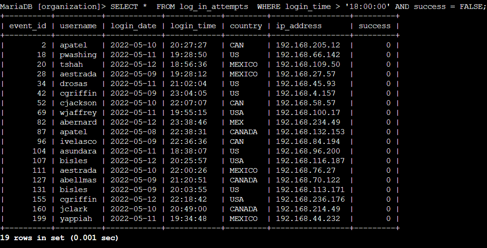
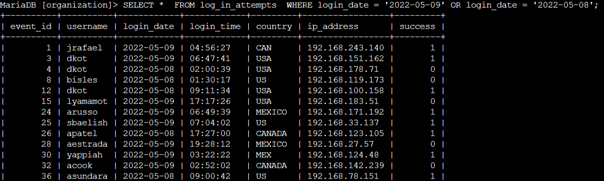
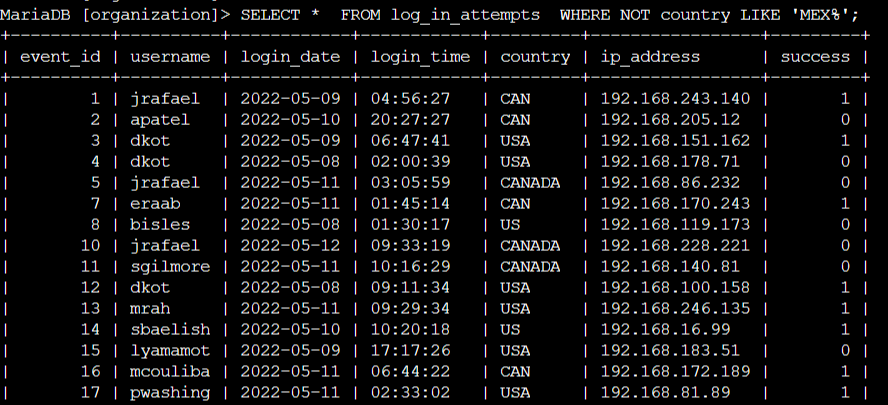
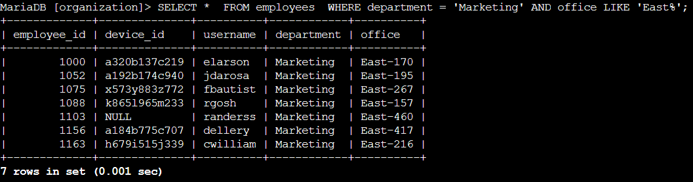
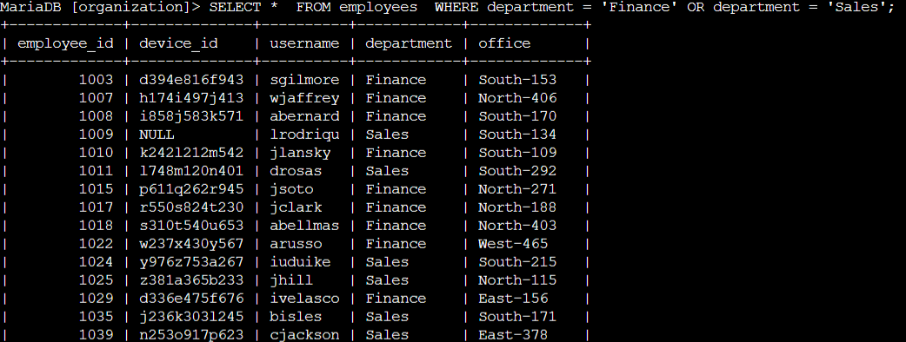
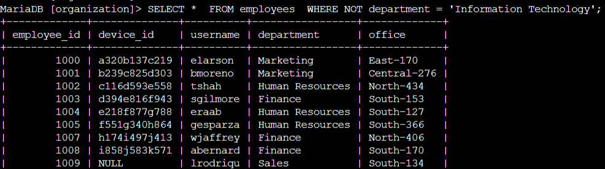

# Apply Filters to SQL Queries - Security Investigation & Data Analysis

As a cybersecurity professional within a large organization, maintaining system security, investigating potential threats, and managing device configurations are critical aspects of protecting enterprise assets. This project documents the use of Structured Query Language (SQL) with conditional filtering to analyze security logs and personnel databases. By leveraging logical operators such as `AND`, `OR`, and `NOT`, alongside pattern-matching wildcards using the `LIKE` keyword, I queried the `log_in_attempts` and `employees` tables to isolate suspicious authentication activity, identify international login anomalies, and scope targeted endpoint security updates across corporate departments.

## Retrieve after hours failed login attempts

A potential security incident was identified involving authentication activity after standard business hours, specifically following 18:00. To assess whether these occurrences represented unauthorized access attempts or system misuse, it was necessary to query the `log_in_attempts` table and isolate all unsuccessful authentication attempts within that time window.

```sql
SELECT * 
FROM log_in_attempts 
WHERE login_time > '18:00:00' AND success = FALSE;
```



The query above retrieves all failed login attempts recorded after 18:00. The process began by selecting all available columns from the `log_in_attempts` table using the asterisk wildcard. A `WHERE` clause was then applied to restrict the results based on two simultaneous conditions connected by the `AND` logical operator. The first condition, `login_time > '18:00:00'`, filters for entries where the login time occurred past 6:00 PM. The second condition, `success = 0` (or `success = FALSE`), narrows the selection exclusively to failed login attempts. Combining these conditions using `AND` ensures that only records satisfying both requirements appear in the final output, providing a clear list of after-hours security events for further investigation.

## Retrieve login attempts on specific dates

A suspicious event was flagged as occurring on 2022-05-09. To conduct a thorough timeline investigation and evaluate potential reconnaissance activity, all login attempts recorded on that specific date as well as the preceding day, 2022-05-08, needed to be retrieved from the database.

```sql
SELECT * 
FROM log_in_attempts 
WHERE login_date = '2022-05-09' OR login_date = '2022-05-08';
```



The query above extracts all login activity that took place on either 2022-05-09 or 2022-05-08. The query targets the `log_in_attempts` table and incorporates a `WHERE` clause utilizing the `OR` logical operator to evaluate multiple target dates. The first condition, `login_date = '2022-05-09'`, captures all events on the primary date of interest, while the second condition, `login_date = '2022-05-08'`, captures entries from the previous day. The `OR` operator was selected instead of `AND` because a single record cannot hold two different date values simultaneously. This ensures that any login attempt matching either of the specified dates is included in the resulting dataset for chronological analysis.

## Retrieve login attempts outside of Mexico

Threat intelligence gathered during the investigation indicated that the suspicious login activity did not originate from regional locations within Mexico. To refine the focus of the investigation and analyze external threat vectors, a query was required to filter out domestic traffic and isolate all login attempts originating from outside Mexico.

```sql
SELECT * 
FROM log_in_attempts 
WHERE NOT country LIKE 'MEX%';
```



The query above returns all recorded login attempts originating from countries other than Mexico. After examining the dataset, it was noted that location entries for Mexico appear as both "MEX" and "MEXICO". To address this variation without constructing multiple explicit conditions, the `LIKE` keyword was combined with the percentage sign (`%`) wildcard pattern `MEX%`, which matches any string beginning with those three letters. By placing the `NOT` logical operator before the `country` column, the query reverses the matching condition, instructing the database engine to exclude all rows where the country field starts with "MEX" and return only international authentication attempts.

## Retrieve employees in Marketing

The security operations team scheduled a mandatory software update for employee computers in the Marketing department who are physically located in the East building. To execute this deployment efficiently, a query was created against the `employees` table to identify the specific devices requiring update packages.

```sql
SELECT * 
FROM employees 
WHERE department = 'Marketing' AND office LIKE 'East%';
```



The query above filters the `employees` table to return all staff members assigned to the Marketing department in the East building. The `WHERE` clause combines two distinct parameters using the `AND` logical operator. The first parameter, `department = 'Marketing'`, isolates personnel within the Marketing division. The second parameter, `office LIKE 'East%'`, uses the `LIKE` keyword with a wildcard to match any office location string starting with "East", such as "East-170" or "East-195". Using `AND` ensures that only employees who meet both criteria—working in Marketing and located in the East facility—are included in the target deployment list.

## Retrieve employees in Finance or Sales

A separate security patch was required for workstations used by personnel in the Finance and Sales departments. Because these teams required the same update package, a query was constructed to generate a combined list of employees belonging to either department.

```sql
SELECT * 
FROM employees 
WHERE department = 'Finance' OR department = 'Sales';
```



The query above selects all employees who belong to either the Finance or Sales departments. The `WHERE` clause employs the `OR` logical operator to evaluate the `department` column against two target strings. The condition `department = 'Finance'` identifies employees in the Finance department, while `department = 'Sales'` identifies those in Sales. The `OR` operator ensures that a row is included if the employee belongs to either of these two groups, aggregating the necessary asset data into a single operational output for the remediation team.

## Retrieve all employees not in IT

To complete the endpoint maintenance initiative, a final security update needed to be applied to all organizational workstations except those belonging to the Information Technology department, which had already received the update during an earlier phase.

```sql
SELECT * 
FROM employees 
WHERE NOT department = 'Information Technology';
```



The query above retrieves all employee records while excluding personnel in the Information Technology department. The `WHERE` clause uses the `NOT` logical operator in conjunction with `department = 'Information Technology'`. This syntax negates the matching criteria, causing the database to filter out all rows associated with the IT department while returning records for all remaining personnel across other organizational divisions.

## Summary

In this project, I applied conditional filtering techniques in SQL to extract specific subsets of data from the `log_in_attempts` and `employees` tables. By combining logical operators (`AND`, `OR`, `NOT`) and pattern-matching wildcards (`LIKE` with `%`), I successfully isolated after-hours failed logins, reconstructed incident timelines across specific dates, filtered out regional traffic, and scoped targeted device updates for various organizational departments. These tasks demonstrate the practical application of SQL queries in supporting defensive security operations, threat investigation, and IT asset management.
