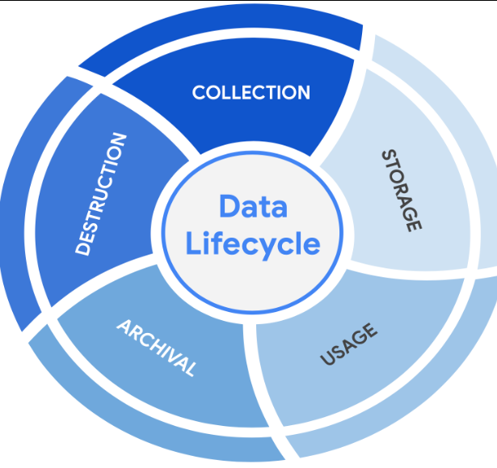

# 📚 Introduction to Asset Security

## 🛡️ Risk, Threat, and Vulnerability Management in Cybersecurity

In cybersecurity, everyday terms take on precise technical definitions essential for incident response and defensive planning.

### 📌 Core Definitions

* **Risk:** Anything that can impact the confidentiality, integrity, or availability of an organizational asset.
* **Threat:** Any circumstance or event with the potential to negatively impact assets.
* **Vulnerability:** A weakness or flaw that can be exploited by a threat to cause harm.

### 🧮 Risk Equation and Management

Risk is not absolute and varies depending on the criticality of each organization's assets. Risk assessment relies on the fundamental formula:

$$
\text{Risk} = \text{Likelihood} \times \text{Impact}
$$

* **Analyst Focus:** Although impact depends on the business context, a security team's daily work focuses on managing and reducing the **likelihood** of occurrence.
* **Key Objectives:** Prevent costly incidents, prioritize critical assets, optimize systems, and define risk tolerance.

### 🔍 Risk Factors: Threats vs. Vulnerabilities

Risk materializes when a threat successfully exploits an existing vulnerability.

#### 1. Categories of Threats

* **Intentional:** Deliberate actions by malicious actors (e.g., an attacker exploiting a misconfigured application).
* **Unintentional:** Accidental events or human errors (e.g., an employee inadvertently granting unauthorized access to a restricted area).

#### 2. Categories of Vulnerabilities

* **Technical:** Hardware, software flaws, or incorrect system configurations.
* **Human:** Behavioral gaps or user lack of awareness (e.g., lost access cards or compromised credentials).

## 📦 Asset Classification and Security Requirements

### 📌 The Importance of Asset Management

* **Core Concept:** Asset management involves tracking assets and the risks that affect them, built on the principle that you can only protect what you know you have.
* **Types of Protected Assets:**
  * **Digital Assets:** Customer data, financial records, and databases.
  * **Information Systems:** Networks, software, and systems that process data.
  * **Physical Assets:** Facilities, equipment, and supplies.
  * **Intangible Assets:** Brand reputation and intellectual property.

### 🏷️ Common Asset Classification Levels

Asset classification labels assets based on their sensitivity and importance to an organization, helping prioritize security resources, reduce IT costs, and ensure legal compliance.

| Classification Level    | Description and Impact                                                       |
| :---------------------- | :--------------------------------------------------------------------------- |
| **Restricted**    | Highest level of sensitivity, reserved for need-to-know information.         |
| **Confidential**  | Disclosure may lead to a significant negative impact on the organization.    |
| **Internal-only** | Assets available to employees and authorized business partners.              |
| **Public**        | Lowest level; release carries no negative consequences for the organization. |

*Note:* Government and public sector organizations often label their most sensitive assets as "Confidential" rather than "Restricted".

### 🧩 Challenges in Classifying Information

* **Determining Ownership:** Identifying asset owners can be tricky, especially when company-issued laptops hold both corporate data and personal user files.
* **Overlapping Classification Levels:** Information can hold multiple sensitivity levels simultaneously (e.g., a person's name is public, but their street address is confidential).

---

## ☁️ The Emergence of Cloud Security

* **Definition:** The UK National Cyber Security Centre defines cloud computing as an on-demand, massively scalable service hosted on shared infrastructure and accessible via the internet.
* **Impact:** Modern cloud technology has lowered barriers to entry for digital businesses, enabling rapid scaling, flexibility, and cost reduction compared to traditional on-premises setups.

### 🛠️ Categories of Cloud-Based Services

Cloud services operate across three primary service models, transferring varying degrees of management responsibility between client and provider:

| Service Model                                | Description                                                                                                     | Primary Use Case / Examples                     |
| :------------------------------------------- | :-------------------------------------------------------------------------------------------------------------- | :---------------------------------------------- |
| **Software as a Service (SaaS)**       | Front-end applications hosted and fully managed by the provider; accessible via web browser.                    | Gmail, Slack, Zoom                              |
| **Platform as a Service (PaaS)**       | Online development environments and back-end tools allowing developers to write, build, and deploy custom apps. | Google App Engine, Heroku, VMware Cloud Foundry |
| **Infrastructure as a Service (IaaS)** | Remote, on-demand access to virtualized computing hardware, storage, processing, and networking.                | Google Cloud Platform, Microsoft Azure          |

### 🤝 The Shared Responsibility Model

Moving to the cloud shifts traditional security boundaries from single internal teams to a shared security framework between provider and customer:

* **Cloud Service Provider (CSP):** Secures underlying infrastructure, physical hardware, core hypervisors, and data centers.
* **Customer / Client:** Responsible for securing elements directly within their operational control:
  * **Identity & Access Management (IAM)**
  * **Resource Configurations**
  * **Data Governance & Handling**
* *Note:* The exact distribution of responsibility varies depending on whether SaaS, PaaS, or IaaS is deployed.

### ⚠️ Key Cloud Security Challenges

* **Misconfiguration:** The single largest operational vulnerability; default or poorly implemented settings leave exposed access points.
* **Cloud-Native Breaches:** Attacks specifically targeting poorly configured cloud services or exposed storage buckets.
* **Visibility & Access Monitoring:** Tracking real-time usage and access rights can be complex across multi-tenant environments.
* **Regulatory Compliance:** Ensuring data storage and transmission comply with legal and industry frameworks (e.g., HIPAA, PCI DSS, GDPR).

---

## 🏛️ NIST Cybersecurity Framework (CSF) Implementation

* **Background:** Originally released in 2014 by the National Institute of Standards and Technology (NIST) to safeguard U.S. critical infrastructure.
* **Scope:** Adapted for public and private organizations of all sizes, providing an unbiased, flexible, and scalable resource for entities lacking dedicated risk framework development resources.
* **Nature:** A voluntary framework comprising standards, guidelines, and best practices to manage cybersecurity risk and support regulatory compliance.

### 🧩 The Three Core Components

The NIST CSF consists of three primary, interconnected components designed to improve organizational security posture:

| Component          | Description                                                                                                                                                                        | Operational Role                                                                                                                    |
| :----------------- | :--------------------------------------------------------------------------------------------------------------------------------------------------------------------------------- | :---------------------------------------------------------------------------------------------------------------------------------- |
| **Core**     | Desired cybersecurity outcomes organized across six functions:**Identify**, **Protect**, **Detect**, **Respond**, **Recover**, and **Govern**. | Serves as an informative reference to categorize assets, establish safeguards, detect threats, and execute response/recovery plans. |
| **Tiers**    | Measured on a scale from**1 to 4** (Tier 1 being the lowest level of implementation maturity).                                                                               | Evaluates program sophistication, assesses security posture, and identifies areas for control improvements.                         |
| **Profiles** | Expert-designed templates tailored to specific risk profiles, industries, or organizational needs.                                                                                 | Establishes operational baselines and enables comparison between current posture and target industry standards.                     |

*Note:* The **Govern** function was added to the Core in February 2024 to emphasize the role of executive leadership and decision-making in risk management.

### ⚙️ CISA Implementation Process

Implementing the CSF can be complex due to its depth. The U.S. Cybersecurity and Infrastructure Security Agency (CISA) recommends a structured four-step lifecycle:

1. **Create a Profile:** Develop a current-state operational profile outlining specific business requirements.
2. **Perform Risk Assessments:** Identify operational gaps against business and regulatory compliance standards.
3. **Analyze and Prioritize Gaps:** Evaluate security deficiencies based on current threat, risk, and vulnerability trends.
4. **Execute Action Plan:** Implement targeted mitigation plans to achieve target-state security objectives

---

---

# 📚 Protect Organizational Assets

## 🔑 The Principle of Least Privilege (PoLP)

* **Definition:** A fundamental security principle stating that users, devices, or applications should only be granted the minimum level of access and authorization required to complete their designated tasks.
* **Primary Objective:** Supports the Confidentiality, Integrity, and Availability (CIA) triad by limiting access to sensitive assets and minimizing the overall attack surface.
* **Related Concept:** Closely linked to **Separation of Duties**, which divides critical tasks among multiple users to prevent any single individual from having total control over sensitive operations.

### 🎯 Key Benefits of Least Privilege

* **Limits Exposure:** Restricts access to sensitive data and prevents unauthorized data theft or leakage.
* **Prevents Accidental Damage:** Reduces the likelihood of accidental file modification, tampering, or deletion by unauthorized accounts.
* **Streamlines Administration:** Enhances system monitoring, logging, and incident investigation.

### 👤 Account Types and Baseline Access

To enforce PoLP, security teams manage individual accounts within directory services based on four primary account categories:

| Account Type                  | Target Audience                                       | Purpose & Risk Profile                                             |
| :---------------------------- | :---------------------------------------------------- | :----------------------------------------------------------------- |
| **Guest Accounts**      | External contractors, clients, or temporary partners. | Granted minimal temporary access to internal networks.             |
| **User Accounts**       | Standard employees and internal staff.                | Permissions strictly tied to daily job responsibilities.           |
| **Service Accounts**    | Applications, automated scripts, and services.        | Enables inter-application communication without human interaction. |
| **Privileged Accounts** | System administrators and IT support staff.           | Elevated administrative access; high target for threat actors.     |

*Note:* Access rights should be dynamic and context-aware (e.g., revoking a support agent's access to customer records as soon as an active support session ends). Secure password hygiene is also essential to prevent account compromise.

### 🔍 Auditing Account Privileges

Regular audits are necessary to maintain least privilege and prevent authorized access rights from degrading over time.

#### 1. Usage Audits

* **Focus:** Reviews active logs to track which resources accounts access and what actions users perform.
* **Goal:** Identifies unused permissions that can be revoked and verifies compliance with organizational policies.

#### 2. Privilege Audits

* **Focus:** Assesses whether user permissions align with current job roles.
* **Goal:** Prevents privilege creep, the gradual accumulation of excess permissions as employees switch roles or receive promotions.

#### 3. Account Change Audits

* **Focus:** Monitors directory service logs for changes made to user accounts.
* **Goal:** Detects unauthorized permission escalation, suspicious activity (such as repeated password reset attempts), and ensures account modifications are authorized.

## 🔄 The Data Lifecycle and Data Governance

### 📌 The Data Lifecycle

* **Definition:** A foundational framework that outlines how information flows through an organization from its initial creation until it is no longer useful.
* **Core Objective:** Guides security controls to ensure data confidentiality, integrity, availability, and recoverability across all states (at rest, in use, and in transit).

5 Stages of the Data Lifecycle:

1. **Collect:** Capturing or acquiring new data from internal or external sources.
2. **Store:** Writing and securing data in databases, servers, or cloud repositories.
3. **Use:** Processing, analyzing, or modifying data to achieve business objectives.
4. **Archive:** Moving inactive data to secure, long-term storage for compliance or reference.
5. **Destroy:** Permanently purging or sanitizing data when it is no longer required.

### 🏛️ Data Governance and Key Roles

Data governance establishes the processes, policies, and structures an organization uses to manage data privacy, accuracy, availability, and security throughout its lifecycle.

| Governance Role          | Primary Responsibility                                           | Focus & Accountability                                                                           |
| :----------------------- | :--------------------------------------------------------------- | :----------------------------------------------------------------------------------------------- |
| **Data Owner**     | Decides who can access, edit, use, or destroy their information. | Grants authority and defines access parameters.                                                  |
| **Data Custodian** | Safely handles, transports, stores, and protects data.           | Enforces security policies, access controls, and technical safeguards (e.g., security analysts). |
| **Data Steward**   | Maintains and implements data governance policies.               | Ensures operational compliance and data quality across business units.                      |

### ⚖️ Legally Protected Information

Regulatory agencies mandate strict default handling guidelines to protect individual privacy rights and ensure data owners maintain control over their personal information.

* **PII (Personally Identifiable Information):** Any information used to trace or infer an individual's identity, contact them, or locate them (e.g., full name, phone number, email address).
* **SPII (Sensitive Personally Identifiable Information):** A sub-category of PII requiring stricter protection and need-to-know access controls (e.g., bank account numbers, login credentials, Social Security numbers).
* **PHI (Protected Health Information):** Information relating to an individual's past, present, or future physical or mental health, medical condition, or healthcare provision.
  * *US Regulation:* Managed under **HIPAA** (Health Insurance Portability and Accountability Act).
  * *EU Regulation:* Managed under **GDPR** (General Data Protection Regulation).

## 🔒 Information Privacy: Regulations, Compliance, and Auditing

### 📌 Information Security vs. Information Privacy

* **Information Privacy:** Refers to protecting personal data from unauthorized access and distribution while granting individuals control over how their data is collected, used, and shared.
* **Information Security (InfoSec):** Refers to protecting data across all states (at rest, in transit, and in use) from unauthorized access, threats, and compromises.
* **Core Connection:** Privacy defines **what** rights data owners have over their information, while security provides the technical safeguards and controls to **enforce** those rights and preserve trust.

---

### 📜 Key Global Privacy Regulations

Regulations establish mandatory standards for data handling and protection to prevent unauthorized disclosure, misuse, and fraud.

| Regulation                                                                | Scope & Target Audience                                                                                                       | Core Focus                                                                                                                                    |
| :------------------------------------------------------------------------ | :---------------------------------------------------------------------------------------------------------------------------- | :-------------------------------------------------------------------------------------------------------------------------------------------- |
| **GDPR** *(General Data Protection Regulation)*                   | Applies to any business handling data of European Union (EU) citizens/residents, regardless of where the business is located. | Empowers data owners with total control over personal data (name, address, health, financial data) and enforces strict handling requirements. |
| **PCI DSS** *(Payment Card Industry Data Security Standard)*      | Applies globally to any entity processing, storing, or transmitting payment card data.                                        | Safeguards credit and debit card transactions against data theft, fraud, and unauthorized exposure.                                           |
| **HIPAA** *(Health Insurance Portability and Accountability Act)* | US federal law governing healthcare providers, insurers, and business associates.                                             | Prohibits unauthorized disclosure of Protected Health Information (PHI) without patient knowledge or consent.                                 |

### 🔍 Security Audits vs. Security Assessments

Organizations validate compliance and resilience through a continuous two-part evaluation cycle:

┌────────────────────────┐      ┌────────────────────────┐
│     Security Audit     				 │      │  Security Assessment  			  │
│                     					         │      │                        					  │
│  Reviews controls     				 │ vs  │  Tests resilience      			          │
│  against standards.  			         │      │  against threats.      				  │
│  (e.g., Annual check)  				 │      │  (e.g., Every 3-6 mos) 				  │
└────────────────────────┘      └────────────────────────┘

#### 1. Security Audits

* **Purpose:** Evaluates whether an organization's existing security controls, policies, and procedures conform to specific legal, regulatory, or internal standards.
* **Frequency & Execution:** Conducted less frequently (typically once per year) by either internal teams or external third-party auditors.

#### 2. Security Assessments

* **Purpose:** Tests and measures how resilient current security implementations are against realistic threat scenarios, identifying hidden vulnerabilities.
* **Frequency & Execution:** Conducted more frequently (every 3 to 6 months) by internal security teams, often to prepare for upcoming formal audits.

---

## 🔐 Symmetric and Asymmetric Encryption

* **Encryption:** The process of converting data from a readable format into an encoded, unreadable ciphertext format to ensure confidentiality.
* **Cipher:** The specific mathematical algorithm used to encrypt and decrypt information.
* **Public Key Infrastructure (PKI):** An overarching encryption framework that secures the exchange of online information and digital certificates.

### ⚖️ Symmetric vs. Asymmetric Encryption

| Encryption Type                 | Key Structure                                                              | Mechanism & Use Case                                                                                                 |
| :------------------------------ | :------------------------------------------------------------------------- | :------------------------------------------------------------------------------------------------------------------- |
| **Symmetric Encryption**  | Uses a **single secret key** shared between the sender and receiver. | The same key encrypts and decrypts the data. Highly efficient and fast, but requires secure key exchange beforehand. |
| **Asymmetric Encryption** | Uses a **public and private key pair**.                              | The public key encrypts data, while the private key (held securely by authorized users) decrypts it.                 |

### 📏 Key Length and Security Trade-offs

* **Brute Force Vulnerability:** Ciphers can be targeted by brute-force attacks, which systematically test potential key combinations until the correct one is found.
* **Key Length Impact:**
  * **Longer keys** increase security exponentially by creating an astronomical number of possible combinations (making brute-forcing take billions of years), but they require more processing time.
  * **Shorter keys** compute faster but offer significantly lower security margins.

### 🛠️ Approved Encryption Algorithms

Modern applications frequently combine symmetric and asymmetric encryption to balance performance and security (e.g., using asymmetric encryption for initial authentication and symmetric encryption for fast session data transfer).

#### 1. Symmetric Algorithms

* **Triple DES (3DES):** A block cipher derived from the older Data Encryption Standard (DES). It applies the DES algorithm three times using three distinct 56-bit keys, resulting in an effective key length of 168 bits. Largely phased out due to data volume limits, but retained for backward compatibility.
* **Advanced Encryption Standard (AES):** A modern, highly secure industry standard utilizing key lengths of **128, 192, or 256 bits**, rendering brute-force attacks computationally infeasible.

#### 2. Asymmetric Algorithms

* **Rivest Shamir Adleman (RSA):** One of the earliest asymmetric algorithms, producing key pairs of **1,024, 2,048, or 4,096 bits** to protect highly sensitive data.
* **Digital Signature Algorithm (DSA):** Introduced by NIST in the 1990s with standard **2,048-bit** keys, widely utilized alongside RSA within public key infrastructure.

### 🔑 Key Generation, Software Security, and Kerckhoff's Principle

* **Key Generation Tools:** OpenSSL is a popular open-source command-line tool used to generate public and private keys and verify digital certificates. Security updates (such as patching the 2014 Heartbleed bug) are critical when utilizing cryptographic software.
* **Kerckhoff's Principle ("Obscurity is not Security"):** A fundamental cryptographic rule stating that a system must remain secure even if everything about the algorithm (except the private key) is public knowledge. Custom, secret algorithms are easily compromised once exposed.

---

## 🧮 The Evolution of Hash Functions

### 📌 Core Hash Concepts & Origins

* **Definition:** Hash functions are one-way cryptographic algorithms that convert data of any size into a unique, fixed-size value known as a **hash digest**.
* **Primary Uses:** Validating file integrity, supporting authentication, and ensuring non-repudiation (proving that data authenticity cannot be denied).
* **Key Characteristic:** Hashes are mathematically irreversible, they cannot be "decrypted" back into plaintext.

### 💥 MD5 and Hash Collisions

* **MD5 (Message Digest 5):** Developed in the early 1990s by Ronald Rivest (MIT) to verify file integrity. It converts input data into a 128-bit value (rendered as a 32-character string).
* **The Collision Problem:** Because hash algorithms map infinite possible inputs to a finite set of possible outputs, **hash collisions** occur when two different inputs produce the exact same hash value.
* **Vulnerability:** Due to its short 128-bit digest length, MD5 is vulnerable to collision attacks, allowing threat actors to forge digital identities or tamper with files without detection.

### 🛡️ The SHA Family (Secure Hashing Algorithms)

To mitigate collision risks, the National Institute of Standards and Technology (NIST) approved the **Secure Hash Algorithm (SHA)** family, producing longer, more collision-resistant digests:

* **SHA-1:** Produces a 160-bit digest (largely phased out due to vulnerabilities).
* **SHA-224 / SHA-256 / SHA-384 / SHA-512:** High-security algorithms generating larger bit lengths (e.g., 256-bit or 512-bit digests) that are significantly more resilient to modern attacks.

### 🔑 Secure Password Storage and Salting

Storing passwords in plaintext exposes an organization to complete credential compromise if a database is breached. Hashing provides a secure alternative, but introduces new risks like **rainbow tables** (pre-computed dictionaries of plaintext passwords matched to their pre-calculated hashes).

* **Salting:** An essential safeguard that appends a random string of characters (a **salt**) to user data before it is hashed.
* **Impact of Salting:** Even if two users share the exact same password (e.g., "password"), the unique salt ensures each resulting hash is completely distinct, neutralizing automated rainbow table attacks.

---

## 🔑 The Rise of SSO and MFA

### 📌 Single Sign-On (SSO) Fundamentals

* **Definition:** A technology that combines multiple login credentials into a single authentication process, combating password fatigue (the tendency to reuse weak passwords across multiple services).
* **Core Benefits:**
  * **User Experience:** Eliminates the need to remember numerous separate usernames and passwords.
  * **Cost Efficiency:** Streamlines administrative management of connected services.
  * **Security Posture:** Reduces the number of access points and potential entry vectors for attackers.
* **How It Works:** Automates trust establishment between identity providers and service providers using encrypted **access tokens**.

#### Key SSO Authentication Protocols

* **LDAP (Lightweight Directory Access Protocol):** Primarily used to transmit authentication and directory information in **on-premises** environments.
* **SAML (Security Assertion Markup Language):** Primarily used to transmit information **off-premises**, such as across cloud environments.
* *Note:* LDAP and SAML protocols are frequently deployed together.

#### ⚠️ Limitations of SSO

While SSO significantly improves usability and reduces entry points, relying on a single set of credentials creates a concentrated risk:

* If a user's primary SSO password or session token is compromised, a threat actor gains access across **multiple connected services** simultaneously.

### 🛡️ Multi-Factor Authentication (MFA) to the Rescue

MFA mitigates single-credential risks by requiring users to verify their identity using **two or more distinct factors** before gaining access to systems or networks.

#### The Three Factors of Authentication

1. **Something you know:** Knowledge-based factors, most commonly passwords or PINs.
2. **Something you have:** Physical or digital tokens, such as a one-time passcode (OTP) sent via SMS or generated by an authenticator app.
3. **Something you are:** Inherent biometric characteristics, such as fingerprints or facial scans.

#### Why MFA Matters in Cloud Security

* Remote cloud environments make it difficult to verify whether a remote user is legitimate.
* Implementing MFA drastically reduces the risk of unauthorized access, as threat actors who steal a password cannot easily bypass the second or third verification factor.

---

## 🆔 Identity and Access Management (IAM) & Access Controls

### 📌 Core Access Principles

To maintain a secure environment, organizations rely on two complementary foundational principles that limit access to resources:

* **Principle of Least Privilege (PoLP):** Users are granted *only* the minimum level of access and authorization required to complete a specific task or function.
* **Separation of Duties (SoD):** Divides critical tasks and responsibilities among multiple people to prevent any single user from having total control over sensitive operations or business functions.

*Note:* Least privilege limits the scope of an individual's access, whereas separation of duties divides multi-step workflows so no single person can execute a process alone.

### 🏛️ Identity and Access Management (IAM) Framework

Both **IAM** and **AAA** (Authentication, Authorization, and Accounting) frameworks consist of security controls designed to ensure that **the right user** is granted access to **the right resources** at **the right time** and for **the right reasons**.

* **Definition:** IAM is a collection of processes and technologies that manage digital identities (people, devices, or software) within an environment.
* **User Provisioning:** The administrative process of creating and maintaining user digital identities and configuring baseline permissions.
* **User Deprovisioning:** The critical security practice of promptly revoking a user's access rights when they no longer require them (e.g., job change or departure).

### 🔐 Authorization Frameworks

Once a user is successfully authenticated, authorization frameworks determine what resources they are permitted to access. There are three primary authorization models:

| Framework                                    | Description                                                                                                                   | Common Use Case                                                     |
| :------------------------------------------- | :---------------------------------------------------------------------------------------------------------------------------- | :------------------------------------------------------------------ |
| **Mandatory Access Control (MAC)**     | The strictest model; access is granted centrally by a system administrator on a strict need-to-know basis. Non-discretionary. | Law enforcement, military, and government agencies.                 |
| **Discretionary Access Control (DAC)** | Access is determined and controlled at the discretion of the individual data owner.                                           | Cloud file sharing (e.g., Google Drive folder permissions).         |
| **Role-Based Access Control (RBAC)**   | Access is assigned automatically based on a user's predefined job role or department within the organization.                 | Enterprise corporate networks (e.g., Marketing vs. IT Admin roles). |
