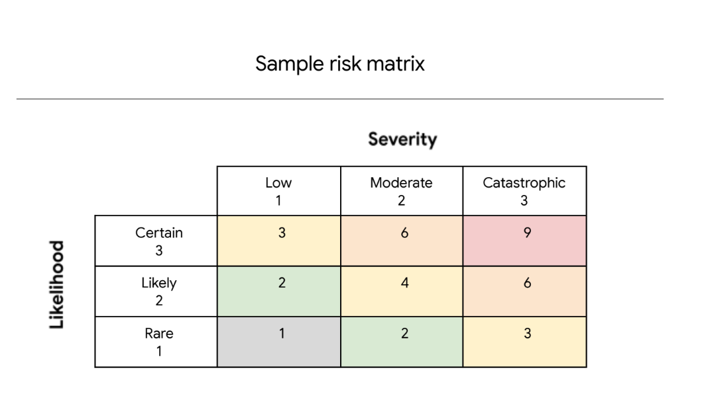

# Commercial Bank Risk Register & Assessment Documentation

## Operational Environment Overview

The bank operates in a coastal region with low local physical crime rates. Data operations are distributed across 100 on-premise employees and 20 remote employees, servicing 2,000 individual accounts and 200 commercial accounts. Marketing partnerships involve a professional sports team and ten local businesses. Operations are governed by strict financial regulatory frameworks requiring high data availability, financial security, and daily compliance with Federal Reserve cash availability thresholds.

## Operating Environment Risk Analysis

**Notes:**
Security events are possible in this operating environment because a distributed workforce of 120 employees increases human vulnerability vectors such as phishing and social engineering. Additionally, managing sensitive accounts across public cloud platforms and remote connections exposes database endpoints to potential data leaks and unauthorized access. Finally, coastal environmental factors introduce weather-driven supply chain threats that can impact daily cash flow requirements.

## Risk Register Matrix

| Asset           | Risk(s)                   | Description                                                   | Likelihood | Severity |  Priority  |
| :-------------- | :------------------------ | :------------------------------------------------------------ | :--------: | :------: | :---------: |
| **Funds** | Business email compromise | An employee is tricked into sharing confidential information. |     2     |    2    | **4** |
| **Funds** | Compromised user database | Customer data is poorly encrypted.                            |     2     |    3    | **6** |
| **Funds** | Financial records leak    | A database server of backed up data is publicly accessible.   |     2     |    3    | **6** |
| **Funds** | Theft                     | The bank's safe is left unlocked.                             |     1     |    2    | **2** |
| **Funds** | Supply chain disruption   | Delivery delays due to natural disasters.                     |     1     |    2    | **2** |

## Risk Evaluation & Scoring Methodology

Risk scores are calculated using the standard formula:

$$
\text{Likelihood} \times \text{Severity} = \text{Priority Score}
$$

### Scoring Scale Definitions

* **Likelihood Scale (1-3):**

  * `1` = Rare / Low chance of occurrence (e.g., infrequent environmental events or rare physical oversights in low-crime regions).
  * `2` = Moderate / Moderate chance of occurrence (e.g., common social engineering attempts or human error in cloud/remote database management).
  * `3` = Certain / High chance of occurrence.
* **Severity Scale (1-3):**

  * `1` = Low Impact (Minor operational impact).
  * `2` = Moderate Impact (Local operational delay or limited financial exposure).
  * `3` = High / Catastrophic Impact (Severe regulatory penalties, widespread loss of customer trust, and major financial liability).

## Priority & Remediation Focus

1. **High Priority (Score: 6) – Data Integrity & Confidentiality:**
   * **Compromised User Database & Financial Records Leak:** These risks carry the highest priority score due to catastrophic regulatory fines from financial watchdogs and severe reputational damage. Technical mitigation (strong encryption at rest, public access removal, and automated audit logging) should be implemented immediately.
2. **Medium Priority (Score: 4) – Human Vector:**
   * **Business Email Compromise:** A moderate likelihood threat driven by remote and on-premise workforce exposure. Phishing simulations and Mandatory Multi-Factor Authentication (MFA) serve as the primary security controls.
3. **Low Priority (Score: 2) – Physical & Environmental Vectors:**
   * **Theft & Supply Chain Disruption:** Low likelihood due to physical low-crime area settings and low frequency of extreme weather events. Standard physical security protocols and liquidity contingency plans suffice for mitigation.

