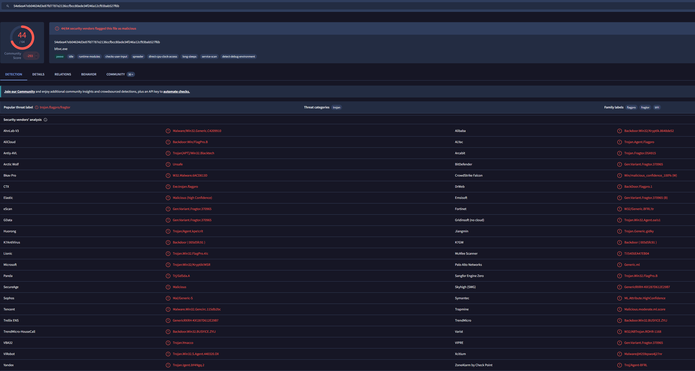
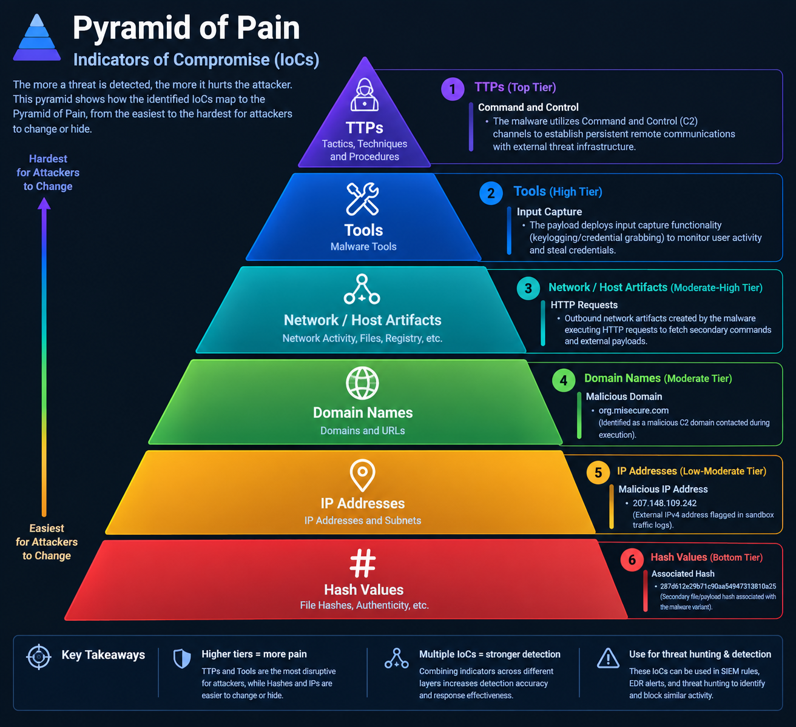

# SOC Incident Analysis: VirusTotal & Pyramid of Pain Investigation

## Exercise Overview & Assessment Process

This independent cybersecurity report documents a Level 1 SOC investigation following an endpoint alert triggered by a suspicious file download. An employee received an email containing a password-protected spreadsheet with the password provided in the message body. Upon opening the file, a malicious payload executed unauthorized files, prompting an intrusion detection system (IDS) alert at 1:20 p.m.

To analyze the incident, the file's SHA256 hash (`54e6ea47eb04634d3e87fd7787e2136ccfbcc80ade34f246a12cf93bab527f6b`) was queried in VirusTotal. The findings were subsequently mapped against the **Pyramid of Pain** framework to categorize indicators of compromise (IoCs) and evaluate attacker capabilities.

---

## Part 1: Malware Maliciousness Assessment

* **Is this file identified as malicious?** **Yes.**
* **Vendor Detection Ratio:** 44 / 64 security vendors
* **Community Score:** -293
* **Primary Payload Name:** `bfsvc.exe`
* **Explanation / Reasoning:**
  Querying the SHA256 hash (`54e6ea47eb04634d3e87fd7787e2136ccfbcc80ade34f246a12cf93bab527f6b`) on VirusTotal yields a clear malicious verdict. As demonstrated in the static detection analysis, 44 out of 64 security vendors flagged the executable payload (`bfsvc.exe`) as malicious, categorizing it primarily as a Trojan/Backdoor variant (`trojan.flagpro/fragtor`).

*Figure 1: VirusTotal detection report confirming 44/64 vendor flags and a community score of -293 for the executable payload (`bfsvc.exe`)*.

---

## Part 2: Pyramid of Pain - Indicators of Compromise (IoCs)

Based on VirusTotal static analysis, relations, and sandbox behavior tabs, the identified IoCs are mapped across the Pyramid of Pain tiers:

### 1. TTPs (Tactics, Techniques, and Procedures) - *Top Tier (Hardest for Attackers)*

* **Command and Control:** The malware utilizes Command and Control (C2) channels to establish persistent remote communications with external threat infrastructure.

### 2. Tools - *High Tier*

* **Input Capture:** The payload deploys input capture functionality (keylogging/credential grabbing) to monitor user activity and steal credentials.

### 3. Network / Host Artifacts - *Moderate-High Tier*

* **HTTP Requests:** Outbound network artifacts created by the malware executing HTTP requests to fetch secondary commands and external payloads.

### 4. Domain Names - *Moderate Tier*

* **Malicious Domain:** `org.misecure.com` (Identified as a malicious C2 domain contacted during execution).

### 5. IP Addresses - *Low-Moderate Tier*

* **Malicious IP Address:** `207.148.109.242` (External IPv4 address flagged in sandbox traffic logs).

### 6. Hash Values - *Bottom Tier (Easiest for Attackers)*

* **Associated Hash:** `287d612e29b71c90aa54947313810a25` (Secondary file/payload hash associated with the malware variant).

---

## Summary

By leveraging VirusTotal crowdsourced threat intelligence and structuring findings according to the Pyramid of Pain, SOC analysts can quickly pivot from low-level indicators (like file hashes) to high-value behavioral defenses (like TTPs and network blocking rules), significantly disrupting the attacker's operational lifecycle.
