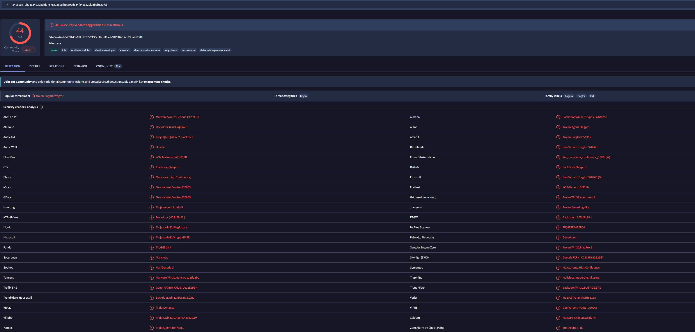

# Incident Response & Escalation Report: Phishing & Ransomware Vector (Alert A-2703)

## Executive Summary

This professional incident report documents the complete Level 1 SOC investigation, threat verification, and playbook escalation process for **Alert Ticket A-2703**. The incident involved a targeted phishing attempt directed at the Human Resources department of a financial services organization, designed to deploy an encrypted malicious payload (`bfsvc.exe`). Threat intelligence validation via VirusTotal confirmed the payload as malicious, prompting an immediate ticket status escalation to Tier 2 incident responders following standardized organizational playbooks.

---

## 1. Incident Ticket Overview (Alert A-2703)

| Field                       | Value / Details                                               |
| :-------------------------- | :------------------------------------------------------------ |
| **Ticket ID**         | `A-2703`                                                    |
| **Alert Message**     | `SERVER-MAIL Phishing attempt possible download of malware` |
| **Alert Severity**    | `Medium`                                                    |
| **Original Status**   | `Open`                                                      |
| **Updated Status**    | `Escalated`                                                 |
| **Target Department** | Human Resources (`hr@inergy.com`)                           |

---

## 2. Evidence & Phishing Artifact Analysis

### Inbound Email Evidence Header & Payload Details

* **Timestamp:** Wednesday, July 20, 2022, at 09:30:14 AM
* **Sender Display Name:** `Def Communications`
* **Sender Email Address:** `<76tguyhh6tgftrt7tg.su>`
* **Sender IP Address:** `114.114.114.114`
* **Recipient Email Address:** `<hr@inergy.com>`
* **Recipient IP Address:** `176.157.125.93`
* **Subject Line:** `Re: Infrastructure Egnieer role`
* **Attachment Name:** `bfsvc.exe`
* **Attachment Encryption Key:** `paradise10789`

```
Email Snippet:
"Dear HR at Ingergy, I am writing for to express my interest in the engineer role 
posted from the website. There is attached my resume and cover letter. For privacy, 
the file is password protected. Use the password paradise10789 to open. Thank you, Clyde West"
```

### Social Engineering & Red Flag Analysis

1. **Sender Address & Display Name Inconsistency:** Discrepancy between the declared sender name ("Def Communications"), the internal signature ("Clyde West"), and an untrusted, high-risk top-level domain (`.su` with random string prefix `76tguyhh6tgftrt7tg`).
2. **Grammatical & Typographical Errors:** Clear red flags in the subject line (*"Egnieer"*) and body text (*"Ingergy"*, *"writing for to express"*).
3. **AV Evasion Techniques:** The attacker utilized password protection (`paradise10789`) on an executable masquerading as a document/resume to evade automated secure email gateway (SEG) content scanning.

---

## 3. Threat Intelligence Validation (VirusTotal Integration)

Static analysis and hash verification were conducted on the extracted payload artifact across crowdsourced threat intelligence engines.

* **Primary SHA256 Hash:** `54e6ea47eb04634d3e87fd7787e2136ccfbcc80ade34f246a12cf93bab527f6b`
* **Associated Secondary Hash (MD5):** `287d612e29b71c90aa54947313810a25`
* **Vendor Detection Verdict:** **44 / 64 Security Vendors Flagged as Malicious**
* **Community Score:** `-293`
* **Threat Classification:** Trojan/Backdoor (`trojan.flagpro/fragtor`)

### Pyramid of Pain Mapping

* **TTPs (Top Tier):** Command and Control (C2) persistence channels.
* **Tools (High Tier):** Input capture / keylogging capabilities.
* **Network/Host Artifacts (Moderate-High Tier):** Outbound HTTP requests triggering payload execution.
* **Domain Names (Moderate Tier):** `org.misecure.com`
* **IP Addresses (Low-Moderate Tier):** `207.148.109.242`
* **Hash Values (Bottom Tier):** SHA256 `54e6ea47eb04634d3e87fd7787e2136ccfbcc80ade34f246a12cf93bab527f6b`



---

## 4. Playbook Execution & Incident Handler Log

```
Playbook Flowchart Navigation:
[Step 1: Receive Alert] -> [Step 2: Evaluate Alert] -> [Step 3.0: Has Attachments? YES] 
-> [Step 3.1: Is Attachment Malicious? YES] -> [Step 3.2: Update & Escalate]
```

### Incident Handler Journal Entry #2

* **Date:** October 20, 2026
* **Entry:** 2
* **Description:** Phishing incident investigation and escalation for Alert A-2703 targeting `hr@inergy.com`.
* **Tools Used:** Email Gateway Security Logs, VirusTotal, Internal Incident Ticketing System.

#### The 5 W's

* **Who caused the incident?** External threat actors spoofing identity details via suspicious address `76tguyhh6tgftrt7tg.su`.
* **What happened?** An employee received a phishing email containing a password-protected malicious executable (`bfsvc.exe`), which was downloaded and executed.
* **When did the incident take place?** July 20, 2022, at 09:30:14 AM.
* **Where did the incident occur?** The workstation assigned to `hr@inergy.com` within the corporate network.
* **Why did it happen?** The attacker used targeted social engineering combined with password-based encryption to bypass perimeter filters and trick the end-user.

---

## 5. Official Ticket Resolution & Escalation Comment

### Updated Ticket Field State

* **Ticket Status:** `Escalated`

### Final Analyst Ticket Comments

> "The alert detected that an employee downloaded and opened a malicious file from a phishing email. There is an inconsistency between the sender’s email address '76tguyhh6tgftrt7tg.su', the name used in the email body 'Clyde West,' and the sender’s name, 'Def Communications.' The email body and subject line contained grammatical errors. The email’s body also contained a password-protected attachment, 'bfsvc.exe,' which was downloaded and opened on the affected machine. Having previously investigated the file hash, it is confirmed to be a known malicious file. Furthermore, the alert severity is reported as medium. With these findings, I chose to escalate this ticket to a level-two SOC analyst to take further action."

---

## 6. Post-Incident Recommendations

1. **Endpoint Containment:** Tier 2 team must immediately isolate the affected machine (`176.157.125.93`) from the local subnet to prevent lateral movement.
2. **Mail Gateway Rule Update:** Blacklist the originating IP (`114.114.114.114`), domain (`org.misecure.com`), and top-level domain extension `.su` at the perimeter firewall/email security platform.
3. **User Security Awareness:** Conduct targeted phishing retraining for HR personnel regarding encrypted external attachments and credential/password-sharing red flags.
